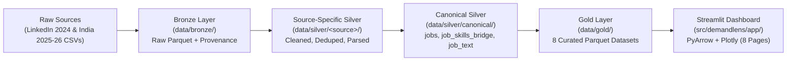

# DemandLens: A Trustworthy Job-Market Intelligence Platform

DemandLens is an end-to-end data engineering and analytics platform that transforms large-scale, heterogeneous job-posting datasets into validated analytical tables and an interactive, evidence-first Streamlit dashboard.

Raw job-market datasets are typically noisy, duplicated across portals, inconsistent in job titles and skill naming, and skewed in sample size and salary disclosure. DemandLens addresses these challenges through a PySpark-based **Medallion Architecture** (Bronze, Source-Specific Silver, Canonical Silver, and Gold) with deterministic cleaning, role and skill standardization, data quality gates, and source-aware visual analytics.

---

## Project Overview

DemandLens processes two static job-market snapshots totaling **1,446,133 canonical job postings** and **27,533,229 job-skill edges**:

1. **Ingests & Preserves Provenance:** Loads raw CSV archives into source-partitioned Bronze Parquet tables with ingestion timestamps and source identifiers.
2. **Cleans & Standardizes:** Deduplicates postings, parses experience and annual INR compensation bands, cleans locations, normalizes skill casing and synonyms, and classifies titles into a 25-role taxonomy.
3. **Integrates Canonically:** Unifies disparate source schemas into a common Canonical Silver model (`jobs`, `job_skills_bridge`, and `job_text`) while strictly preserving `source_id`.
4. **Publishes Gold Analytics:** Builds eight curated Parquet datasets covering market overview, geographic demand, employer volume, skill prevalence, role-skill matrices, skill co-occurrence, India salary benchmarks, and entry-level career pathways.
5. **Visualizes with Analytical Safeguards:** Serves an interactive 8-page Streamlit and Plotly dashboard directly from Gold Parquet files via PyArrow, enforcing relative prevalence (%) for cross-source comparisons and minimum sample-size thresholds for salary cohorts.

---

## Key Capabilities

- **Multi-Source Medallion Pipeline:** PySpark ETL pipelines spanning Bronze, Source-Specific Silver, Canonical Silver, and Gold layers stored in Apache Parquet.
- **Deterministic Role Standardization:** Spark-native Catalyst regex engine mapping raw job titles into 25 standardized role families (`DATA_ENGINEER`, `SOFTWARE_ENGINEER`, `AI_ENGINEER`, etc.) without Python UDF serialization overhead.
- **Skill Normalization & Graph Edges:** Extracts, cleans, and normalizes skill tags across 27.5M+ canonical job-skill relationships.
- **Data Quality & Atomic Writes:** Schema validation, null/integrity checks, and staging-to-target promotion with rollback support for Gold builds.
- **Eight Gold Analytical Datasets:** Pre-aggregated, dashboard-ready Parquet cubes for fast interactive querying without runtime Spark overhead.
- **Interactive 8-Page Dashboard:** Research-grade Streamlit UI with persistent source selection, cascading filters, `Data scope` disclosures, and formatted CSV exports.
- **Salary Cohort Protection:** Enforces minimum sample size (`n >= 3`) and cascading Role → Seniority Tier → Location filters on India annual INR compensation data.

---

## System Architecture

DemandLens follows a six-stage local data flow from raw CSV archives to the interactive presentation layer:



| Layer | Location | Responsibility |
|---|---|---|
| **Bronze** | `data/bronze/` | Source-oriented raw ingestion into Parquet with `source_id` and ingestion metadata. |
| **Source-Specific Silver** | `data/silver/<source>/` | Schema alignment, deduplication, location/text cleaning, salary/experience parsing, and skill normalization. |
| **Canonical Silver** | `data/silver/canonical/` | Unified cross-source data model (`jobs`, `job_skills_bridge`, `job_text`) preserving `source_id`. |
| **Gold** | `data/gold/` | Role standardization and eight pre-aggregated analytical Parquet datasets. |
| **Dashboard** | `src/demandlens/app/` | Lightweight PyArrow + Pandas + Plotly + Streamlit UI reading Gold Parquet tables directly. |

---

## Data Sources

DemandLens currently integrates two **static, orthogonal job-market snapshots** (not live job feeds):

### 1. LinkedIn Jobs & Skills 2024
- **Kaggle Dataset:** [`asaniczka/1-3m-linkedin-jobs-and-skills-2024`](https://www.kaggle.com/datasets/asaniczka/1-3m-linkedin-jobs-and-skills-2024)
- **License:** Open Data Commons Attribution License (ODC-By v1.0)
- **Scale & Coverage:** **1,348,454** canonical postings across early 2024, weighted toward Western markets (`US`, `GB`, `CA`, `AU`). Distributed as three relational CSVs (`linkedin_job_postings.csv`, `job_skills.csv`, `job_summary.csv`) joined on `job_link`.
- **Key Characteristics:** Broad omni-economy role coverage; third-party NER-extracted skill tags; **0% disclosed salary data**; keyword- and city-driven search harvest.

### 2. Indian Job Market Dataset 2025–2026
- **Kaggle Dataset:** [`shivamshrivastava21/indian-job-market-dataset-2025-2026`](https://www.kaggle.com/datasets/shivamshrivastava21/indian-job-market-dataset-2025-2026)
- **Scale & Coverage:** **97,679** canonical postings focused on the Indian employment market (`IN`), heavily skewed toward technology and IT services roles.
- **Key Characteristics:** Includes experience ranges and annual INR compensation strings (disclosed on **~34%** of postings); relative upload strings (`"4 Days Ago"`, `"30+ Days Ago"`); no full multi-paragraph job description bodies.

> Because the two snapshots differ by 13.8:1 in raw volume and cover different geographies, periods, and sectors, cross-source comparisons in DemandLens use **relative prevalence (%)** rather than raw posting counts.

---

## Data Processing Architecture

### Bronze Layer (`data/bronze/`)
- Converts source CSVs into columnar Parquet using PySpark with multi-line quote handling to prevent row tearing in descriptions.
- Enriches records with `source_id` and ingestion timestamps for full provenance and auditing.

### Source-Specific Silver (`data/silver/<source>/`)
- **LinkedIn 2024:** Left-joins postings with `job_skills` and `job_summary`, deduplicates by `job_link`, cleans locations, normalizes skill tags, and classifies freshness/workplace mode.
- **Indian Job Market 2025–2026:** Parses experience bounds (`minimumExperience`, `maximumExperience`), normalizes annual INR salary bounds into numeric values (treating `"Not Disclosed"` as `NULL`, never `0`), cleans Indian city strings, and normalizes skill tags.

### Canonical Silver (`data/silver/canonical/`)
Unifies both sources into three canonical Parquet tables while preserving `source_id`:
- **`jobs` (1,446,133 rows):** Core job attributes (standardized identifiers, cleaned title, company, location, country code, workplace mode, seniority tier, salary bounds, freshness).
- **`job_skills_bridge` (27,533,229 edges):** Normalized `(source_id, job_id, skill)` bridge table supporting skill-level aggregations.
- **`job_text` (1,395,011 descriptions):** Canonical posting text payloads retained for downstream text analytics.

### Gold Layer (`data/gold/`)
All eight Gold datasets are built by PySpark aggregation scripts in `scripts/gold_*.py` and validated before atomic promotion:

| Gold Dataset | Purpose | Key Information Provided |
|---|---|---|
| `job_market_overview` | Macro KPI cube | Total, remote, hybrid, and onsite posting counts by source, country, seniority, and freshness. |
| `job_demand_by_location` | Geographic hiring demand | City/region posting volume, country share (%), and remote/hybrid penetration (min 5 postings). |
| `job_demand_by_company` | Employer demand & breadth | Company posting counts, workplace mode breakdown, distinct roles, and distinct locations. |
| `skill_demand_overall` | Market-level skill rankings | Skill posting counts, market rank, and relative prevalence (%) by `(source_id, country_code, skill)` (min 10 postings). |
| `role_skill_matrix` | Role competency profiles | Skill occurrence counts, requirement frequency (%), and rank per `(source_id, standardized_role, skill)` (min 5 occurrences). |
| `skill_cooccurrence` | Skill affinity & pairing | Co-occurring skill pairs and Jaccard similarity across the top 300 skills per source (min 15 co-occurrences). |
| `salary_analytics_india` | India compensation benchmarks | Annual INR salary percentiles (P25, median, P75) by `(standardized_role, seniority_tier, location_clean)` (min sample size = 3). |
| `career_pathways_entry_level` | Early-career opportunities | Entry-level role volumes, starter-skill prevalence (%), and remote entry-level share by source and country. |

---

## Dashboard

The Streamlit dashboard (`src/demandlens/app/streamlit_app.py`) organizes eight analytical pages into three navigation groups:

| Group | Page | Analytical Focus & Safeguards |
|---|---|---|
| **Market** | **Overview** | Macro stat strip, computed key findings, country distribution, 100% stacked workplace mix, and top standardized roles with unclassified-role toggle. |
| **Market** | **Locations** | Country-filtered top hiring locations ranked by posting count alongside a remote-share summary table. |
| **Market** | **Companies** | Top employers by posting volume, company name search filter, and role/location breadth table. |
| **Skills** | **Skill Demand** | Within-market skill prevalence (%) rankings paired with a US vs. India overlapping-skills prevalence comparison. |
| **Skills** | **Role-Skill Matrix** | Required skills bar chart for a selected standardized role alongside a single-hue cross-role skill frequency heatmap. |
| **Skills** | **Skill Co-occurrence** | Anchor-skill companion explorer ranked by Jaccard similarity with co-occurrence counts in hover tooltips and tables. |
| **Outcomes** | **Salary** | India annual INR compensation (LPA) benchmarks with sample-weighted P25–P75 range bars, cascading Role → Seniority Tier → Location filters, and `n >= 3` cohort protection. |
| **Outcomes** | **Career Pathways** | Entry-level role volumes and starter-skill prevalence (%) per target role (`ENTRY`/`ASSOCIATE` in LinkedIn; `ENTRY` or `<= 2` years experience in India). |

Every page includes a **Data scope** popover documenting snapshot boundaries, a Gold build date footer read directly from Parquet `_gold_timestamp` metadata, and a collapsible **Underlying data** table with CSV export.

---

## Technology Stack

| Layer | Technology | Purpose |
|---|---|---|
| **Language** | Python (3.11+ / 3.12) | Core pipeline logic, data loaders, and application code |
| **Distributed Processing** | Apache Spark / PySpark (`>=3.5.0`) | Bronze, Silver, Canonical Silver, and Gold ETL transformations |
| **Tabular Processing** | Pandas (`>=2.0.0`), PyArrow (`>=14.0.0`) | Direct Gold Parquet reads and dashboard data shaping |
| **Storage Format** | Apache Parquet | Columnar local storage across Bronze, Silver, and Gold layers |
| **Dashboard & Charts** | Streamlit (`>=1.35.0`), Plotly (`>=5.20.0`) | Interactive 8-page analytical UI and custom-themed charts |
| **Configuration** | python-dotenv (`>=1.0.0`), TOML | Local environment paths and Streamlit theme configuration |
| **Testing** | pytest (`>=8.0.0`) | Unit, transformation, Gold validation, and Streamlit `AppTest` suites |
| **Version Control** | Git | Source control |

---

## Repository Structure

```text
DemandLens/
├── .streamlit/                 # Streamlit theme, font-face, and static-serving config
├── config/                     # Source configuration files and reference HTML snapshots
├── data/                       # Local Medallion storage (gitignored Parquet/CSV payloads)
│   ├── source_csv/             # Downloaded raw Kaggle archives and extracted CSVs
│   ├── bronze/                 # Raw ingested Parquet tables
│   ├── silver/                 # Source-specific Silver and canonical/ unified tables
│   └── gold/                   # Eight curated analytical Parquet datasets
├── docs/
│   ├── architecture/           # Medallion, Silver, Canonical, and Gold design specs
│   ├── reports/                # Data inspection and validation reports
│   ├── DESIGN_SYSTEM.md        # Dashboard UI tokens, chart rules, and component catalog
│   ├── data_sources.md         # Source schemas, licensing, and domain audit
│   └── market_comparison_design.md
├── notebooks/                  # Exploratory Jupyter notebooks
├── scripts/                    # CLI runners for Bronze, Silver, Canonical, and Gold jobs
├── src/demandlens/
│   ├── ingestion/              # Bronze CSV-to-Parquet ingestion modules
│   ├── silver/                 # Cleaning, parsing, normalization, and canonical transforms
│   ├── quality/                # Dataset quality inspection utilities
│   ├── gold/                   # Role standardization engine and Gold utilities
│   ├── app/                    # Streamlit dashboard, pages, charts, labels, and components
│   └── rag/                    # Reserved module stub for future RAG integration
├── static/                     # Global CSS stylesheet for the dashboard
├── tests/                      # Unit, pipeline, regression, and AppTest suites
├── .env.example                # Environment variable template
├── .gitignore                  # Excludes venvs, local datasets, Spark artifacts, and secrets
├── requirements.txt            # Python dependencies
└── README.md                   # Project documentation
```

---

## Installation and Setup

### Prerequisites
- **Git** (2.40+)
- **Python** (3.11 or 3.12)
- **Java JDK 17** (required only if running PySpark Bronze/Silver/Gold pipeline scripts locally, with `JAVA_HOME` configured)

### 1. Clone and Configure Virtual Environment (Windows PowerShell)

```powershell
git clone <repository-url>
cd DemandLens

python -m venv .venv
.\.venv\Scripts\Activate.ps1

pip install -r requirements.txt
copy .env.example .env
```

### 2. Data Prerequisites

Large source CSVs and generated Parquet files are excluded from Git via `.gitignore`.
- **To run the dashboard directly:** Ensure the eight Gold Parquet directories exist under `data/gold/`.
- **To rebuild the pipeline from raw data:** Download the two Kaggle datasets listed in [Data Sources](#data-sources), place them under `data/source_csv/linkedin_2024/` and `data/source_csv/indian_job_market_2025_2026/`, and run the Bronze → Source-Specific Silver → Canonical Silver → Gold scripts in `scripts/`.

---

## Running the Dashboard

From the repository root (`D:\DemandLens`), launch the Streamlit application:

```powershell
.\.venv\Scripts\python.exe -m streamlit run src\demandlens\app\streamlit_app.py --server.port 8501
```

Open **`http://localhost:8501`** in your browser. The dashboard reads directly from `data/gold/*.parquet` via PyArrow and does not require a running Spark session.

---

## Testing

DemandLens includes unit tests, PySpark transformation tests, Gold aggregation and atomic-promotion tests, salary filter regression tests, and Streamlit `AppTest` smoke tests across all eight pages.

Run the test suite from the repository root:

```powershell
.\.venv\Scripts\pytest.exe tests -v
```

> Note: Full pipeline and dashboard tests expect the corresponding Silver/Gold Parquet data directories to be present locally.

---

## Data and Storage Notice

- **Excluded from Version Control:** Raw Kaggle CSVs and generated Bronze, Silver, and Gold Parquet files are gitignored (preserving folder structure with `.gitkeep`) to keep the repository lightweight and respect dataset redistribution terms.
- **Local Storage:** The current implementation stores all Medallion layers locally as Apache Parquet files under `data/`.
- **Static Snapshots:** Analytical outputs reflect the 2024 LinkedIn and 2025–2026 Indian Job Market snapshots rather than live streaming job feeds.

---

## Limitations

- **Snapshot Period & Sector Skew:** `linkedin_2024` reflects early 2024 Western omni-economy postings, whereas `indian_job_market_2025_2026` reflects 2025–2026 tech-skewed Indian postings. Raw counts cannot be compared directly across sources.
- **Incomplete Salary Disclosure:** LinkedIn 2024 provides 0% salary data and is excluded from salary benchmarks. Indian Job Market 2025–2026 discloses annual INR salary on ~34% of postings; non-disclosed postings are excluded rather than imputed.
- **Role Standardization Coverage:** Deterministic title rules classify core engineering, data, product, cloud, and security roles; a large share of non-tech or niche Indian postings (~82%) map to `OTHER_SPECIALIZED` or `UNCLASSIFIED` (excluded by default in role-focused charts, with an explicit UI toggle).
- **Minimum Sample-Size Thresholds:** Salary cohorts require `sample_size >= 3`, overall skills require `>= 10` postings, role-skill pairs require `>= 5`, and locations require `>= 5` postings to suppress noisy long-tail outliers.
- **Raw Entity Strings:** Employer names reflect source-cleaned strings (both direct employers and staffing agencies appear), and some location strings retain source-level multi-city or modality prefixes.

---

## Future Enhancements

The following capabilities are planned for future development and are **not yet implemented**:

- **RAG-Based Job-Description Search:** Semantic retrieval over `job_text` descriptions using vector embeddings and an LLM interface (`src/demandlens/rag/`).
- **Relational & Vector Serving:** PostgreSQL + `pgvector` backend for hybrid SQL and semantic analytics.
- **Automated Incremental Ingestion:** Scheduled ingestion pipelines and cloud object storage (e.g., AWS S3).
- **Expanded Role & Company Normalization:** Broader non-tech role taxonomy coverage and employer entity resolution.

---

## Acknowledgements and References

- **LinkedIn Jobs & Skills (2024):** [Asaniczka on Kaggle](https://www.kaggle.com/datasets/asaniczka/1-3m-linkedin-jobs-and-skills-2024) (ODC-By v1.0)
- **Indian Job Market Dataset (2025–2026):** [Shivam Shrivastava on Kaggle](https://www.kaggle.com/datasets/shivamshrivastava21/indian-job-market-dataset-2025-2026)
- **Core Frameworks:** [Apache Spark / PySpark](https://spark.apache.org/docs/latest/api/python/), [Apache Arrow / PyArrow](https://arrow.apache.org/docs/python/), [Streamlit](https://docs.streamlit.io/), [Plotly](https://plotly.com/python/), [pytest](https://docs.pytest.org/)
