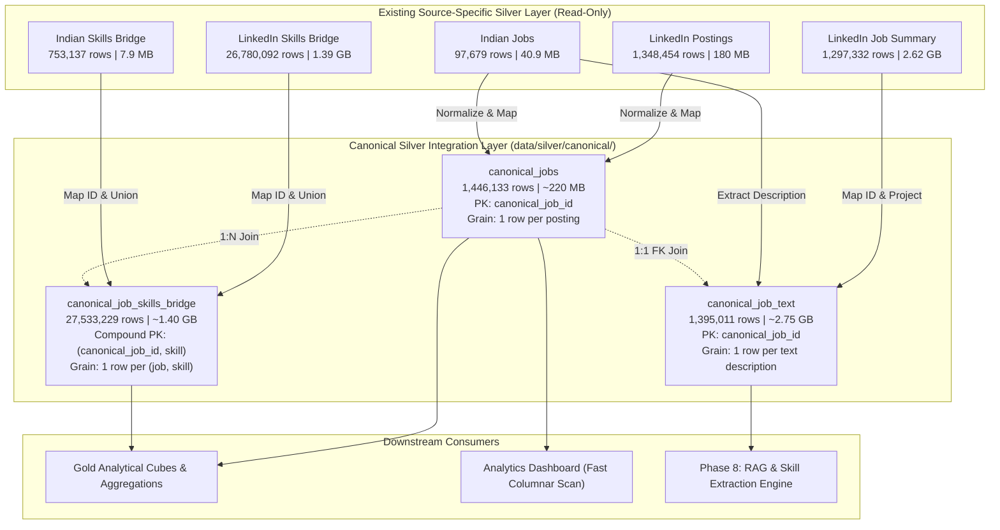
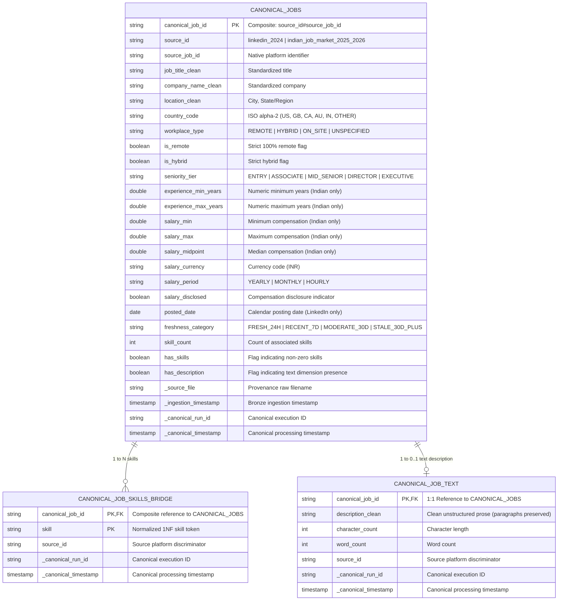

# DemandLens — Architecture Design: Canonical Silver Integration (Phase 6D.4)

**Document:** Canonical Silver Layer Integration & Schema Specification  
**Milestone:** Phase 6D.4 — Silver Integration Preflight & Design  
**Author:** Data Architecture & Engineering (DemandLens Team)  
**Status:** **DRAFT / ARCHITECTURAL SPECIFICATION**  
**Creation Date:** 2026-11-26  
**Scope:** Architectural Design & Contract Specification (NO TRANSFORMATION EXECUTION)  

---

## 1. Executive Summary & Purpose

DemandLens ingests and standardizes heterogeneous labor market data across multiple distinct geographic and temporal sources:
1. **LinkedIn Jobs & Skills 2024:** 1,348,454 postings, 26,780,092 skills, and 1,297,332 long-form unstructured summaries covering Western markets (US, GB, CA, AU).
2. **Indian Job Market Dataset 2025–2026:** 97,679 postings and 753,137 skill bridge records covering the Indian subcontinent with explicit compensation and experience metrics.

To date, Phase 6B, 6C, 6D.1, 6D.2, and 6D.3 have transformed these disparate Bronze collections into source-specific Silver tables. However, downstream Gold aggregations, analytical BI dashboards, and RAG retrieval pipelines require a unified access layer.

**The core architectural challenge:** Creating a canonical schema that enables cross-dataset querying without:
- Obliterating source-specific attributes (e.g. Indian Lakhs compensation vs. Western seniority levels).
- Introducing misleading comparisons (e.g. comparing INR salaries directly to USD or treating missing salaries as zero).
- Bloating columnar dimensional tables by denormalizing 5 GB of unstructured text into high-frequency analytical queries.
- Merging records across sources without defensible entity-matching rationale.

This document establishes the official architectural blueprint, schema contracts, integration topology, and analytical guardrails for the **DemandLens Canonical Silver Layer**.



---

## 2. Source-Specific Silver Baseline Audit

The canonical design is grounded in the physical reality of the 5 verified Silver datasets:

| Table Identifier | Physical Storage Path | Partitions | Row Count | Storage Footprint | Primary Key / Grain | Key Unique Attributes |
| :--- | :--- | :---: | :---: | :---: | :--- | :--- |
| **LinkedIn Postings** | `data/silver/linkedin_2024/job_postings` | 4 parts | 1,348,454 | 179.98 MB | `job_link` | Western countries, strict remote/hybrid split, seniority tier, search position. |
| **LinkedIn Skills** | `data/silver/linkedin_2024/job_skills_bridge`| 8 parts | 26,780,092 | 1,389.62 MB | `(job_link, skill)` | 1NF normalized skill tokens, technical symbol preservation. |
| **LinkedIn Summary** | `data/silver/linkedin_2024/job_summary` | 22 parts | 1,297,332 | 2,687.12 MB | `job_link` | Long text (5 GB uncompressed), character & word counts, paragraph preservation. |
| **Indian Jobs** | `data/silver/indian_job_market_2025_2026/jobs` | 2 parts | 97,679 | 40.93 MB | `job_id` | INR salary ranges, min/max experience years, reviews, embedded job description. |
| **Indian Skills** | `data/silver/indian_job_market_2025_2026/job_skills_bridge` | 2 parts | 753,137 | 7.92 MB | `(job_id, skill)` | 1NF normalized skills derived from `tagsAndSkills`. |

---

## 3. Source Compatibility & Incompatibility Analysis

Before unifying columns, a forensic compatibility assessment must define where datasets converge and where they fundamentally diverge:

### 3.1 Geographic Incompatibility
- **LinkedIn 2024:** Represents North American, British, and Australasian job markets (`search_country` mapped to `US`, `GB`, `CA`, `AU`, and `OTHER`).
- **Indian Market 2025–2026:** Represents 100% domestic Indian labor demand (`country = 'IN'`), centered on major tech corridors (Bengaluru, Hyderabad, Pune, Mumbai, Delhi-NCR).
- **Architectural Directive:** Datasets are **geographically orthogonal**. The canonical layer must enforce a standard ISO-3166-1 alpha-2 `country_code` on every record. Downstream dashboards must mandate geographic filtering so Indian compensation is never aggregated alongside Western compensation.

### 3.2 Compensation & Currency Divergence
- **LinkedIn 2024:** Contains **0% salary disclosure**. The source data scrape contains no wage columns.
- **Indian Market 2025–2026:** Contains explicit numeric salary ranges (`salary_min`, `salary_max`, `salary_midpoint`, `salary_period`) denominated exclusively in **INR** (Indian Rupee).
- **Architectural Directive:**
  - LinkedIn salary fields in the canonical table must be explicit `NULL`.
  - A boolean flag `salary_disclosed` must be present.
  - Analytics Guardrail: Calculations such as `AVG(salary_midpoint)` must explicitly require `WHERE salary_disclosed = True AND country_code = 'IN'`. Analysts must never substitute 0 for missing salary values.

### 3.3 Experience & Seniority Representation
- **Indian Market:** Features quantitative experience requirements (`experience_min_years`, `experience_max_years`) parsed from text like `3-7 Yrs`.
- **LinkedIn:** Lacks numeric years entirely; contains only categorical `job_level` ('Mid-Senior level', 'Associate', 'Entry level', 'Director', 'Executive').
- **Architectural Directive:**
  - Both datasets converge on the standardized categorical column `seniority_tier` (`ENTRY`, `ASSOCIATE`, `MID_SENIOR`, `DIRECTOR`, `EXECUTIVE`, `UNSPECIFIED`).
  - Quantitative experience columns (`experience_min_years`, `experience_max_years`) are populated for Indian records and populated as `NULL` for LinkedIn records. No synthetic numeric years may be imputed for LinkedIn.

### 3.4 Workplace Arrangement Classification
- **LinkedIn:** Explicit source column `job_type` allows deterministic separation of `REMOTE` (is_remote=True, is_hybrid=False), `HYBRID` (is_remote=False, is_hybrid=True), and `ON_SITE`.
- **Indian Market:** Classified from location strings and title keywords. Contains `is_remote` (True/False).
- **Architectural Directive:**
  - Canonical schema adopts the 3-state enum: `workplace_type` (`REMOTE`, `HYBRID`, `ON_SITE`, `UNSPECIFIED`) along with explicit boolean indicators `is_remote` and `is_hybrid`.
  - Invariant: `is_remote = True` implies 100% remote work; hybrid roles have `is_remote = False` and `is_hybrid = True`.

### 3.5 Temporal & Freshness Incompatibility
- **LinkedIn:** Explicit calendar date `first_seen_date` (e.g. `2024-01-15`) and scrape timestamp `last_processed_timestamp`.
- **Indian Market:** Relative text scrape dates (e.g. `1 day ago`, `30+ days ago`) mapped to categorical `freshness_tier` (`FRESH_24H`, `RECENT_7D`, `MODERATE_30D`, `STALE_30D_PLUS`).
- **Architectural Directive:**
  - Do NOT synthesize absolute calendar dates from relative scrape offsets unless anchored to an immutable scrape batch date.
  - Provide both `posted_date` (nullable Date) and `freshness_category` (standardized tier string).
  - Invalidate time-series comparisons across sources; LinkedIn represents early 2024, Indian dataset represents late 2025/early 2026.

### 3.6 Text Dimension Bloat (The Decoupling Mandate)
- Denormalizing the 5.0 GB LinkedIn `job_summary` text into the main jobs table would balloon `canonical_jobs` from **~220 MB to >3.0 GB**.
- Analytical queries aggregate metrics across job titles, skills, locations, and salaries; they do not need raw paragraph text.
- **Architectural Directive:** Text summaries and descriptions must be isolated in a dedicated 1:1 linked table: `data/silver/canonical/job_text`.

---

## 4. Canonical Schema Specification

### 4.1 Primary Entity: `canonical_jobs`
**Destination:** `data/silver/canonical/jobs`  
**Expected Rows:** 1,446,133  
**Grain:** Exactly 1 row per unique job posting across all ingested platforms.  
**Primary Key:** `canonical_job_id` (Composite string: `<source_id>#<source_job_id>`).

| Column Name | Physical Type | Nullable | Source Availability | Transformation & Mapping Invariant |
| :--- | :--- | :---: | :--- | :--- |
| `canonical_job_id` | `string` | **False** | Both | Composite surrogate key: `concat(col("_source_id"), lit("#"), col("source_job_id"))`. Guaranteed globally unique. |
| `source_id` | `string` | **False** | Both | Platform discriminator: `'linkedin_2024'` or `'indian_job_market_2025_2026'`. |
| `source_job_id` | `string` | **False** | Both | Native platform key: `job_link` (LinkedIn) or `job_id` (Indian). |
| `job_title_clean` | `string` | **False** | Both | Standardized job title; whitespace normalized, outer punctuation trimmed. Genuine NULLs prohibited (fallback to 'UNSPECIFIED'). |
| `company_name_clean` | `string` | True | Both | Standardized company name; whitespace normalized, legal suffixes preserved. |
| `location_clean` | `string` | True | Both | Standardized location string (City, State/Region). |
| `country_code` | `string` | **False** | Both | ISO 3166-1 alpha-2 code: `US`, `GB`, `CA`, `AU`, `IN`, or `OTHER`. |
| `workplace_type` | `string` | **False** | Both | Standardized categorization: `'REMOTE'`, `'HYBRID'`, `'ON_SITE'`, `'UNSPECIFIED'`. |
| `is_remote` | `boolean` | **False** | Both | `True` strictly for 100% remote roles; `False` for hybrid and on-site. |
| `is_hybrid` | `boolean` | **False** | Both | `True` strictly for hybrid roles; `False` for remote and on-site. |
| `seniority_tier` | `string` | **False** | Both | Harmonized tier: `'ENTRY'`, `'ASSOCIATE'`, `'MID_SENIOR'`, `'DIRECTOR'`, `'EXECUTIVE'`, `'UNSPECIFIED'`. |
| `experience_min_years` | `double` | True | Indian only | Minimum quantitative experience requirement. Always `NULL` for LinkedIn. |
| `experience_max_years` | `double` | True | Indian only | Maximum quantitative experience requirement. Always `NULL` for LinkedIn. |
| `salary_min` | `double` | True | Indian only | Minimum compensation boundary in native currency. Always `NULL` for LinkedIn. |
| `salary_max` | `double` | True | Indian only | Maximum compensation boundary in native currency. Always `NULL` for LinkedIn. |
| `salary_midpoint` | `double` | True | Indian only | Median compensation boundary (`(salary_min + salary_max) / 2`). Always `NULL` for LinkedIn. |
| `salary_currency` | `string` | True | Indian only | ISO currency code (e.g. `'INR'`). Always `NULL` for LinkedIn. |
| `salary_period` | `string` | True | Indian only | Periodicity: `'YEARLY'`, `'MONTHLY'`, `'HOURLY'`. Always `NULL` for LinkedIn. |
| `salary_disclosed` | `boolean` | **False** | Both | Indicator: `True` if valid non-null salary range is present; `False` otherwise. |
| `posted_date` | `date` | True | LinkedIn only | Calendar date of job posting (`first_seen_date`). `NULL` for Indian relative dates. |
| `freshness_category` | `string` | True | Indian (primary) | Standardized freshness tier: `'FRESH_24H'`, `'RECENT_7D'`, `'MODERATE_30D'`, `'STALE_30D_PLUS'`. |
| `skill_count` | `integer` | **False** | Both | Total distinct normalized skills mapped in `canonical_job_skills_bridge`. |
| `has_skills` | `boolean` | **False** | Both | `True` if `skill_count > 0`; `False` otherwise. |
| `has_description` | `boolean` | **False** | Both | `True` if matching text record exists in `canonical_job_text`; `False` otherwise. |
| `_source_file` | `string` | **False** | Both | Provenance tracking raw input filename. |
| `_ingestion_timestamp`| `timestamp` | True | Both | Bronze lineage timestamp. |
| `_canonical_run_id` | `string` | **False** | Both | Unique execution identifier for the canonical integration job. |
| `_canonical_timestamp`| `timestamp` | **False** | Both | UTC timestamp when canonical record was generated. |

---

### 4.2 Secondary Entity: `canonical_job_skills_bridge`
**Destination:** `data/silver/canonical/job_skills_bridge`  
**Expected Rows:** 27,533,229  
**Grain:** Exactly 1 row per unique `(canonical_job_id, skill)` pair.  
**Compound Primary Key:** `(canonical_job_id, skill)`.

| Column Name | Physical Type | Nullable | Description & Mapping Rule |
| :--- | :--- | :---: | :--- |
| `canonical_job_id` | `string` | **False** | Foreign key linking directly to `canonical_jobs.canonical_job_id`. |
| `skill` | `string` | **False** | Standardized, normalized skill token (Phase 6B rules). Lowercase, trimmed, technical symbols preserved (`c++`, `c#`, `.net`, `node.js`, `sql`, `pl/sql`, `ci/cd`). |
| `source_id` | `string` | **False** | Source attribution (`'linkedin_2024'` or `'indian_job_market_2025_2026'`). |
| `_canonical_run_id` | `string` | **False** | Canonical integration execution run ID. |
| `_canonical_timestamp`| `timestamp` | **False** | UTC processing timestamp. |

---

### 4.3 Text Dimension: `canonical_job_text`
**Destination:** `data/silver/canonical/job_text`  
**Expected Rows:** 1,395,011 (1,297,332 LinkedIn + 97,679 Indian)  
**Grain:** Exactly 1 row per job posting containing long-form text.  
**Primary Key:** `canonical_job_id`.

| Column Name | Physical Type | Nullable | Description & Mapping Rule |
| :--- | :--- | :---: | :--- |
| `canonical_job_id` | `string` | **False** | 1:1 Foreign key linking to `canonical_jobs.canonical_job_id`. |
| `description_clean`| `string` | **False** | Cleansed plain-text description. HTML tags stripped, entities decoded, whitespace normalized, paragraph boundaries (`\n\n`) preserved. |
| `character_count` | `integer` | **False** | Length in characters of `description_clean`. |
| `word_count` | `integer` | **False** | Whitespace-delimited word count of `description_clean`. |
| `source_id` | `string` | **False** | Source attribution identifier. |
| `_canonical_run_id` | `string` | **False** | Canonical integration execution run ID. |
| `_canonical_timestamp`| `timestamp` | **False** | UTC processing timestamp. |

---

## 5. Architectural Entity-Relationship Model



---

## 6. Analytics Guardrails & Defensive Query Rules

To prevent misleading cross-platform aggregations and analytical contamination, downstream BI layers and analysts must adhere to the following governance contracts:

### Guardrail 1: The Compensation Segregation Rule
- **Violation:** Calculating `AVG(salary_midpoint)` across the whole table returns an erroneous figure because 1,348,454 LinkedIn records are NULL.
- **Enforcement:** BI tools and queries must mandate:
  ```sql
  WHERE salary_disclosed = True AND salary_currency = 'INR' AND country_code = 'IN'
  ```
- **Rule:** Never compare Indian salaries (in INR) to Western figures without explicit purchasing-power parity (PPP) conversion models. Never fill missing salary values with zero.

### Guardrail 2: The Remote Work Invariant
- **Violation:** Counting `is_remote = True` and assuming it includes hybrid jobs leads to gross underestimation of flexible work policies.
- **Enforcement:**
  - Fully remote: `WHERE is_remote = True AND is_hybrid = False` (or `workplace_type = 'REMOTE'`).
  - Hybrid arrangements: `WHERE is_hybrid = True AND is_remote = False` (or `workplace_type = 'HYBRID'`).
  - Total flexible work opportunities: `WHERE workplace_type IN ('REMOTE', 'HYBRID')`.

### Guardrail 3: Relative vs. Absolute Skill Demand
- **Violation:** Aggregating raw skill counts across datasets creates artificial dominance for LinkedIn because LinkedIn contains 26.78M skill rows vs. 0.75M for India (35:1 ratio).
- **Enforcement:** Skill penetration must always be expressed as **relative frequency within source**:
  $$\text{Relative Skill Frequency} = \frac{\text{Postings Requiring Skill } S \text{ in Source } X}{\text{Total Postings in Source } X}$$
- Cross-platform ranking must compare percentile ranks or relative penetration percentages, not raw record counts.

### Guardrail 4: Temporal Non-Equivalence
- **Violation:** Plotting a continuous time series from early 2024 (LinkedIn) through late 2025/2026 (Indian Market).
- **Enforcement:** Time-series charts must be segmented by `source_id`. LinkedIn data represents a discrete Q1 2024 snapshot; Indian data represents an operational 2025–2026 snapshot.

---

## 7. Storage, Partitioning & Computational Estimates

*All metrics in this section are analytical projections derived from verified Silver layer physical baselines.*

| Canonical Entity | Projected Rows | Est. Total Size (Parquet) | Partition Strategy | Part File Count | Target File Size |
| :--- | :---: | :---: | :--- | :---: | :---: |
| **`canonical_jobs`** | **1,446,133** | **~220 MB** | Partitioned by `country_code` or uniform 8 parts | 8–10 parts | ~22–27 MB / part |
| **`canonical_job_skills_bridge`** | **27,533,229** | **~1,400 MB (1.37 GiB)**| Uniform hash partition on `canonical_job_id` | 16 parts | ~87 MB / part |
| **`canonical_job_text`** | **1,395,011** | **~2,750 MB (2.69 GiB)**| Uniform 22 parts matching upstream summary | 22 parts | ~125 MB / part |
| **Total Canonical Footprint** | **30,374,373** | **~4,370 MB (~4.27 GiB)**| — | **46–48 parts** | — |

### Storage Feasibility on Rishi's Workstation
- Drive `D:` Free Space: **206.95 GiB**.
- Projected Canonical Footprint: **~4.27 GiB**.
- Post-Integration Free Space: **>202.6 GiB** (Remaining free space: ~81.0%).
- Conclusion: Physical disk headroom is more than sufficient.

---

## 8. Directory Layout & Physical File Architecture

```
D:\DemandLens\data\silver\canonical\
├── jobs\                               <-- Canonical core dimension
│   ├── part-00000.parquet
│   ├── ...
│   └── part-00007.parquet
├── job_skills_bridge\                  <-- Canonical 1NF skill bridge
│   ├── part-00000.parquet
│   ├── ...
│   └── part-00015.parquet
├── job_text\                           <-- Decoupled plain-text dimension
│   ├── part-00000.parquet
│   ├── ...
│   └── part-00021.parquet
└── _metadata\                          <-- Canonical lineage & manifest store
    ├── canonical_jobs_manifest.json
    ├── canonical_skills_manifest.json
    └── canonical_text_manifest.json
```

---

## 9. Implementation Architecture & Execution Engine Strategy

To prevent Windows socket pipeline bottlenecks and JVM off-heap exhaustion:
1. **Catalyst-First Projections:** Column mapping, concatenation, and case-folding must use pure PySpark Catalyst expressions (`when`, `concat`, `lit`, `coalesce`, `trim`). Row-by-row Python UDFs are strictly prohibited for structural projection.
2. **PyArrow Streaming Committer:** Write partitions using the established DemandLens hybrid committer in bounded batches of 10,000 rows.
3. **Staging Isolation:** Build each table in isolated staging folders on drive `D:` (`_staging_canonical_jobs_<uuid>`), execute data quality gates, and atomically promote via `shutil.move()`.
4. **Referential Gate Invariant:** Every `canonical_job_id` present in `canonical_job_skills_bridge` and `canonical_job_text` must exist in `canonical_jobs` (0 orphan records permitted).
