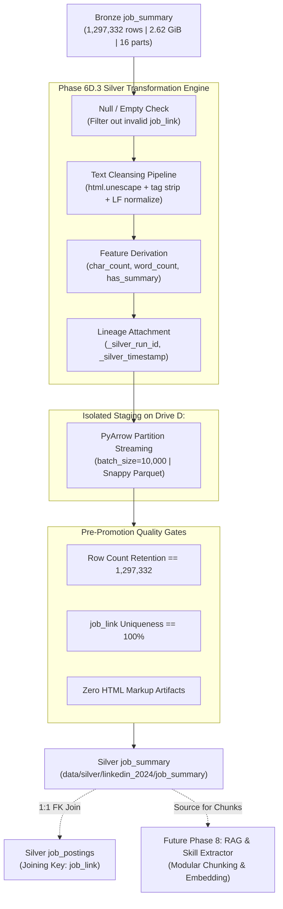
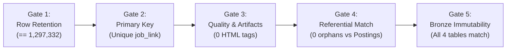

# DemandLens — Architecture Design: LinkedIn Job Summary Silver Transformation

**Document:** Architecture Design & Engineering Specification  
**Milestone:** Phase 6D.3 — LinkedIn Job Summary Silver Transformation  
**Input Source:** `data/bronze/linkedin_2024/job_summary` (Bronze Parquet, Snappy, 16 partitions)  
**Target Destination:** `data/silver/linkedin_2024/job_summary` (Silver Parquet, Snappy, 16 partitions)  
**Status:** DRAFT / PENDING APPROVAL  

---

## 1. Executive Summary & Architectural Context

In the DemandLens data lakehouse architecture, Phase 6D transforms raw LinkedIn 2024 Bronze datasets into standardized, clean, analytics-ready Silver tables.
- **Phase 6D.1 (Completed):** Standardized core job posting dimensions (`data/silver/linkedin_2024/job_postings`, 1,348,454 rows, 180 MB).
- **Phase 6D.2 (Completed):** Transformed normalized skill tokens into a 1NF bridge table (`data/silver/linkedin_2024/job_skills_bridge`, 26,780,092 rows, 1.39 GB).
- **Phase 6D.3 (Current):** Cleans and standardizes long-form unstructured job descriptions into a dedicated Silver text dimension (`data/silver/linkedin_2024/job_summary`, 1,297,332 rows).

This specification details a memory-conscious, streaming-oriented transformation engine that handles **~5.0 GB of raw unstructured English prose** without risking Java Virtual Machine (JVM) socket timeouts, Python worker Out-Of-Memory (OOM) failures, or cross-table performance degradation.



---

## 2. Source Data Profiling & Characteristics

A forensic profiling of the raw Bronze `job_summary` dataset reveals the following empirical baseline:

| Metric | Measured Baseline | Architectural Implication |
| :--- | :--- | :--- |
| **Source Row Count** | **1,297,332 records** | 100% 1:1 match with raw source CSV (`job_summary.csv`) |
| **Physical Storage (Bronze)** | **2,682.73 MiB (2.620 GiB)** | 16 Snappy Parquet partitions (~167.7 MB each) |
| **Estimated Raw Text Volume** | **~4.96 GB uncompressed** | Must not be collected into driver RAM |
| **Average Character Length** | **3,826.9 characters / summary** | ~500–700 words per job description |
| **Maximum Character Length** | **22,774 characters** | Outlier long descriptions require robust regex parsers |
| **Minimum Character Length** | **21 characters** | Tiny stubs exist and must be preserved |
| **Null Summaries** | **0 (0.00%)** | Zero null text entries in Bronze source |
| **Empty / Whitespace Stubs** | **0 (0.00%)** | Preflight confirmed zero blank strings in Bronze |
| **HTML Tag Prevalence** | **~0.11% of records** | Contains markup like `<p>`, `<br>`, `<li>`, `<div>`, `<strong>` |
| **HTML Entity Prevalence** | **~0.11% of records** | Contains encoded entities like `&amp;`, `&quot;`, `&#39;`, `&nbsp;` |
| **Key Column** | `job_link` (String) | 100% unique primary key matching `job_postings` |

---

## 3. Modular Lakehouse Design & RAG Readiness

### 3.1 Why Job Summary Must Remain a Modular Table
A fundamental tenet of modern lakehouse architecture is **separation of columnar dimensions by access frequency and payload size**:
1. **Preventing Tabular Dimension Bloat:**  
   The primary `job_postings` table is lightweight (**180 MB** across 1.35M rows, ~133 bytes/row) and queried constantly for high-speed aggregations (salary distributions, location filters, remote ratios, company rankings).  
   *Antipattern:* If the 5.0 GB unstructured summary text were denormalized into `job_postings`, the table size would balloon from 180 MB to **>2.8 GB**. Every simple analytical query would incur a massive I/O tax scanning gigabytes of irrelevant text columns.
2. **Modular 1:1 Foreign Key Linking:**  
   By maintaining `job_summary` as an independent Silver table linked via `job_link`, analytics engines can query tabular attributes at lightspeed and perform an `INNER JOIN` or `LEFT JOIN` on `job_link` strictly when full-text retrieval or keyword regex search is requested.

### 3.2 RAG (Retrieval-Augmented Generation) Readiness
The Silver job summary table serves as the authoritative, clean foundation for future Phase 8 Generative AI and RAG pipelines:
- **Clean Plain-Text Ingestion:** RAG chunking and tokenizers (e.g. `tiktoken`, HuggingFace tokenizers) perform poorly when parsing raw HTML boilerplate (`<div>`, `&amp;nbsp;`). Standardizing text in Silver ensures clean semantic chunks.
- **Strictly No Premature Embeddings:** Embedding generation (e.g. dense vectors from `text-embedding-3-small` or `bge-large-en`) requires significant GPU/API compute and cost. Silver must strictly store clean plain text and lexical metadata; dense vector indexing belongs to dedicated downstream vector stores (Chroma, Qdrant, or FAISS).
- **Sentence & Paragraph Preservation:** Naive whitespace collapsing that removes linebreaks damages sentence boundary detection. The Silver normalization rules explicitly retain paragraph boundaries (`\n\n`) to enable structural semantic chunking.

---

## 4. Silver Target Schema Specification

The Silver `job_summary` table adheres to the following strict schema:

| Column Name | Physical Type | Logical Meaning / Transformation Logic | Nullable |
| :--- | :--- | :--- | :---: |
| `job_link` | `string` | Primary key linking to `job_postings.job_link`. | **False** |
| `summary_clean` | `string` | Plain-text job description with HTML stripped, entities decoded, and whitespace normalized. | True |
| `character_count` | `integer` | Length of `summary_clean` (`length(summary_clean)`). | True |
| `word_count` | `integer` | Estimated word count (`size(split(summary_clean, '\\s+'))`). | True |
| `has_summary` | `boolean` | Flag indicating non-empty summary (`character_count > 0`). | **False** |
| `_source_id` | `string` | Source provenance identifier (`'linkedin_2024'`). | **False** |
| `_source_file` | `string` | Raw file provenance (`'job_summary.csv'`). | **False** |
| `_ingestion_timestamp` | `timestamp` | Bronze lineage timestamp from ingestion run. | True |
| `_ingestion_run_id` | `string` | Bronze lineage execution run ID. | True |
| `_silver_run_id` | `string` | Silver pipeline execution ID (`'silver_summary_run_<ts>_<hash>'`). | **False** |
| `_silver_timestamp` | `timestamp` | UTC timestamp when Silver transformation was executed. | **False** |

---

## 5. Text Cleansing & Normalization Rules

The text cleansing engine builds upon the thoroughly tested foundation in `src/demandlens/silver/text_cleaning.py`:

### Rule 1: HTML Entity Decoding
- Uses Python `html.unescape()` to resolve standard HTML entities and numeric character references:
  - `&amp;` $\rightarrow$ `&`
  - `&quot;` $\rightarrow$ `"`
  - `&#39;` / `&apos;` $\rightarrow$ `'`
  - `&lt;` $\rightarrow$ `<`
  - `&gt;` $\rightarrow$ `>`
  - `&nbsp;` $\rightarrow$ ` ` (space)

### Rule 2: Structural Block Tag Translation
- Before stripping raw markup, block-level tags that imply paragraph breaks are translated to newline characters:
  - `<br\s*/?>` $\rightarrow$ `\n`
  - `</?(p|li|div|tr|h[1-6])\b[^>]*>` $\rightarrow$ `\n`
- This ensures bullet points and paragraphs do not run into adjacent text (e.g. `<li>Python</li><li>SQL</li>` becomes `Python\nSQL`, not `PythonSQL`).

### Rule 3: HTML Tag Removal
- Remaining inline tags (e.g. `<span>`, `<strong>`, `<em>`, `<a>`, `<b>`) are replaced with a single space using regex `<[^>]+>`.

### Rule 4: Multiline Paragraph Normalization
- Standardizes all line endings (`\r\n` and `\r`) to standard Unix line feed `\n`.
- Strips trailing whitespace per line (`line.rstrip()`).
- Collapses 3 or more consecutive newlines (`\n{3,}`) into a double newline (`\n\n`), cleanly delineating distinct paragraphs without excessive vertical gaps.
- Trims overall leading and trailing whitespace.

### Rule 5: Technical Term & Punctuation Preservation
- Does **not** strip internal programming language symbols or special punctuation:
  - Technical acronyms: `CI/CD`, `TCP/IP`, `PL/SQL`, `ETL/ELT`
  - Languages and frameworks: `C++`, `C#`, `.NET`, `Node.js`, `Vue.js`
  - Financial & compensation terms: `$120k`, `€65,000`, `£45k - £55k`
  - Punctuation: commas, colons, hyphens, and periods are fully preserved for readability and linguistic chunking.

---

## 6. Execution Architecture & Memory Bounding

Processing 1.297 million long-form text summaries on a single workstation requires strict resource governance:

### 6.1 Hybrid Spark + PyArrow Streaming Committer
- Spark reads the 16 Bronze Parquet files in parallel.
- A partition-level worker closure applies the cleansing pipeline over iterators of `Row` dicts.
- **Bounded Batch Processing:** Records are streamed into PyArrow in batches of **10,000 rows** (`~38 MB` of text per batch).
- PyArrow streams batches directly to disk in Snappy-compressed Parquet files via `pq.ParquetWriter`.
- This ensures that driver RAM usage stays flat (< 2 GB), completely eliminating memory spikes and avoiding full-dataset materialization.

### 6.2 Staging Isolation & Atomic Promotion
To prevent incomplete writes or corrupted directories:
1. Output is streamed to an isolated staging folder on drive `D:`:  
   `data/silver/linkedin_2024/_staging_job_summary_<uuid>`
2. Pre-promotion data quality gates evaluate row counts, schema, and compression.
3. Upon gate approval, `shutil.move()` atomically promotes staging to:  
   `data/silver/linkedin_2024/job_summary`
4. Manifest metadata is committed to `data/silver/linkedin_2024/_metadata/`.
5. In case of error, the staging folder is automatically removed in a `finally:` block.

### 6.3 Resource Configuration
```python
spark = (
    SparkSession.builder.appName("DemandLens-LinkedIn-JobSummary-Silver")
    .master("local[*]")
    .config("spark.driver.memory", "6g")
    .config("spark.driver.maxResultSize", "2g")
    .config("spark.sql.shuffle.partitions", "16")
    .config("spark.default.parallelism", "8")
    .config("spark.local.dir", "D:/DemandLens/data/temp_validation/spark_tmp")
    .config("spark.driver.extraJavaOptions", "-Djava.io.tmpdir=D:/DemandLens/data/temp_validation/spark_tmp")
    .getOrCreate()
)
```

---

## 7. Quality Gates & Validation Plan

The Phase 6D.3 pipeline enforces the following mandatory pre-promotion and post-execution quality gates:



| Quality Gate | Validation Invariant | Evaluation Method | Pass Criteria |
| :--- | :--- | :--- | :--- |
| **1. Row Count Retention** | Output row count must exactly match Bronze input | `pq.ParquetFile.metadata.num_rows` | Exactly **1,297,332 rows** |
| **2. Key Uniqueness** | `job_link` must be 100% unique primary key | PyArrow dataset unique count | `distinct(job_link) == 1,297,332` |
| **3. Null Key Rejection** | Zero null or empty `job_link` values | `pc.is_null(job_link)` | Exactly **0** null keys |
| **4. HTML Artifact Absence** | Cleaned summaries must contain no raw HTML tags | Regex `<[^>]+>` across sample | **0** unstripped HTML tags |
| **5. Entity Resolution** | Common HTML entities must be decoded | Regex `&[a-z]+;|&#\d+;` | **0** residual entities |
| **6. Word & Char Consistency**| Derived metrics must be strictly non-negative | `character_count >= 0`, `word_count >= 0` | 100% compliance |
| **7. Referential Integrity** | All summary keys must reference valid postings | Left anti join against `job_postings` | **0 orphan records** |
| **8. Partition File Balance** | Parquet partitions must be uniform and Snappy | File size and compression audit | 16 Snappy files (~160 MB each) |
| **9. Bronze Immutability** | All 4 Bronze tables remain 100% byte-intact | Parquet metadata checksum | 100% row match across all Bronze |
| **10. Staging Cleanup** | Zero residual staging directories on disk | Filesystem directory scan | `len(staging_dirs) == 0` |

---

## 8. Synthetic Unit & Integration Test Plan

Before executing the full production pipeline on 1.297 million rows, dedicated test suites will validate pipeline fidelity using synthetic fixtures:

1. **`test_summary_text_cleansing_rules`:**
   - Tests HTML unescaping (`&amp;`, `&quot;`, `&#39;`).
   - Tests line-break conversion for `<p>`, `<br>`, `<li>`, `<div>`.
   - Tests multiline paragraph collapsing (`\n{3,}` $\rightarrow$ `\n\n`).
   - Tests technical token retention (`C++`, `.NET`, `Node.js`, `SQL`).
2. **`test_summary_derived_metrics`:**
   - Verifies `character_count` equals `len(summary_clean)`.
   - Verifies `word_count` accuracy across single-line and multiline text.
   - Verifies `has_summary` boolean logic.
3. **`test_summary_null_and_empty_handling`:**
   - Verifies that null or whitespace-only inputs result in `summary_clean = None`, `character_count = 0`, `word_count = 0`, `has_summary = False`.
4. **`test_summary_transformer_grain_and_provenance`:**
   - Runs synthetic Spark DataFrame through `transform_linkedin_job_summary`.
   - Asserts schema compliance and lineage metadata (`_silver_run_id`, `_silver_timestamp`).

---

## 9. Estimated Storage & System Impact

| Metric | Estimated Value | Notes |
| :--- | :---: | :--- |
| **Input Bronze Storage** | 2,682.73 MiB (2.62 GiB) | Snappy Parquet (16 files) |
| **Output Silver Storage** | **~2,500 – 2,700 MiB (~2.5 GiB)** | Snappy Parquet (16 files, ~160 MB each) |
| **Peak Staging Disk Footprint** | ~2.60 GiB | Cleared immediately upon promotion |
| **Available D: Drive Space** | **209.69 GiB** | Vast headroom (>200 GB remaining after execution) |
| **Total Disk Utilization Delta** | ~1.2% of D: drive | Completely safe and sustainable |
| **Estimated Pipeline Runtime** | **~180 – 240 seconds** | ~3 to 4 minutes on 8-core CPU |

---

## 10. Conclusion & Approval Checkpoint

The design specified herein satisfies all architectural tenets of DemandLens:
- **Scalability:** Bounded streaming ensures zero risk of memory exhaustion.
- **Data Quality:** Comprehensive HTML decoding and paragraph normalization prepare text for RAG without loss of technical terms.
- **Lakehouse Modularity:** Preserves `job_summary` as a standalone dimension linked by `job_link`, protecting `job_postings` from performance degradation.
- **Governance:** Full audit trail, immutable Bronze layer, and atomic staging promotion.

Execution of the Phase 6D.3 pipeline will commence upon explicit user review and approval.
