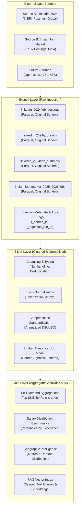

# DemandLens: Medallion Data Architecture Specification

## 1. Overview & Architectural Vision

**DemandLens** is an end-to-end, trustworthy job-market intelligence platform designed to process, analyze, and surface actionable insights from diverse job posting sources.

To provide clean data lineage, robust quality checks, and support future analytical dashboards and Retrieval-Augmented Generation (RAG) assistants, DemandLens implements a multi-tier **Medallion Architecture**:



---

## 2. Multi-Source Ingestion Strategy

DemandLens ingests heterogeneous job posting sources that vary dramatically in schema, geographic scope, and data granularity:

1. **Source A (LinkedIn Jobs & Skills 2024):**
   - High-volume global snapshot (1.35M postings across US, UK, Canada, Australia).
   - Normalized 3-table structure joined by `job_link`.
   - Rich, long-form job descriptions (median length ~3,367 characters).
   - Lacks explicit numeric salary columns.
2. **Source B (Indian Job Market Dataset 2025–2026):**
   - Focused regional snapshot (97,929 postings across Indian metros from Naukri.com).
   - Single wide-table format (17 columns) with primary key `jobId`.
   - Rich structured salary attributes (`minimumSalary`, `maximumSalary`, `currency`).
   - Relative posting date strings and concise summary snippets.
3. **Future Sources (Extensibility):**
   - Scalable architecture permits registering new sources (e.g., Open Jobs ATS Parquet files, job board APIs) through declarative JSON configurations in `config/sources/` without rewriting ingestion pipelines.

---

## 3. Bronze Layer: Raw Source Preservation

The **Bronze Layer** acts as the immutable, append-only landing zone for all raw data.

### 3.1 Guiding Principles
- **100% Fidelity:** Source columns, original names, data types, and null representations are preserved exactly as received.
- **Zero Destructive Cleaning:** No filtering, deduplication, string stripping, or schema casting is performed in Bronze.
- **Optimized Storage Format:** Data is converted from raw CSV/Excel into columnar, snappy-compressed **Apache Parquet**. This reduces disk footprint by 70–80% and accelerates downstream query scans.
- **Partitioning & File Sizing:** Tables are partitioned into clean 100–150 MB part files (e.g. 4 partitions for postings, 16 for summaries), preventing the "small file problem" while enabling distributed Spark processing.
- **Isolated Storage Layout:**
  - `data/bronze/linkedin_2024/job_postings/`
  - `data/bronze/linkedin_2024/job_skills/`
  - `data/bronze/linkedin_2024/job_summary/`
  - `data/bronze/indian_job_market_2025_2026/jobs/`

### 3.2 Ingestion Provenance Metadata
Every Bronze record is enriched with system-managed metadata columns:
- `_source_id`: Explicit source code (e.g., `linkedin_2024`, `indian_job_market_2025_2026`).
- `_source_file`: Specific input file from which the record originated.
- `_ingestion_timestamp`: Precise UTC timestamp of the ingestion run.
- `_ingestion_run_id`: Unique execution identifier linking to the run audit manifest in `_metadata/`.

---

## 4. Planned Silver Layer: Cleaning, Normalization & Canonical Schema

The **Silver Layer** transforms raw Bronze data into a clean, query-ready, and standardized analytical foundation.

### 4.1 Data Cleaning & Deduplication
- **Deduplication:** Deduplicate job records based on primary identifiers (`job_link` for LinkedIn, `jobId` for Indian data).
- **Missing Value Handling:** Replace empty strings and missing categorical attributes with standardized placeholders (e.g., `"Unknown Company"`, `"Unspecified"`).
- **Date Standardization:** Parse absolute ISO dates where available; categorize relative posting text into freshness tiers (`fresh <24h`, `moderate <7d`, `stale >30d`).

### 4.2 Attribute Normalization
- **Skills Normalization:** Convert raw comma-delimited skill strings into native Spark arrays (`ArrayType(StringType())`), apply lowercase normalization, and strip leading/trailing whitespace.
- **Salary Standardization:**
  - Cast numeric salary strings to doubles.
  - Map `0` values from undisclosed entries to `NULL`.
  - Standardize periodicity to annual compensation (Annualized INR / USD).
- **Experience Brackets:** Convert text experience ranges into integer `experience_min_years` and `experience_max_years`.

### 4.3 Unified Canonical Job Model
Silver projects source-specific structures into a shared, source-agnostic schema:
```sql
CREATE TABLE silver_jobs (
    job_id              VARCHAR PRIMARY KEY,
    source_id           VARCHAR NOT NULL,
    source_dataset      VARCHAR NOT NULL,
    job_title           VARCHAR NOT NULL,
    job_title_clean     VARCHAR,
    company_name        VARCHAR,
    location_raw        VARCHAR,
    country             VARCHAR,
    city                VARCHAR,
    is_remote           BOOLEAN,
    employment_type     VARCHAR,
    experience_min      INT,
    experience_max      INT,
    salary_min          DOUBLE,
    salary_max          DOUBLE,
    salary_currency     VARCHAR,
    salary_period       VARCHAR,
    skills_array        VARCHAR[],
    job_description     TEXT,
    posting_date        DATE,
    freshness_tier      VARCHAR,
    _ingestion_time     TIMESTAMP
);
```

---

## 5. Planned Gold Layer: Aggregated Analytics & AI Intelligence

The **Gold Layer** houses purpose-built analytical marts and semantic embeddings:

1. **Skill Demand Mart:**
   - Skill frequency, growth trends, co-occurrence matrices, and skill premiums by role family and seniority.
2. **Compensation Benchmark Mart:**
   - Median, 25th, and 75th percentile salary benchmarks segmented by role, experience tier, and metropolitan location.
3. **Market Comparison Mart:**
   - Cross-source comparison metrics contrasting historical LinkedIn global patterns against contemporary Indian tech hiring dynamics.
4. **RAG Vector Knowledge Base:**
   - Job description text chunks cleaned of boilerplate and stored alongside dense embeddings for semantic retrieval, candidate resume matching, and LLM-driven job-market Q&A.

---

## 6. Local Processing & Cloud Scalability

- **Current Architecture:**
  - 100% local processing utilizing **Apache PySpark (local[*])** on Windows 10/11.
  - Standalone JDK 24 and native Hadoop Windows utilities (`winutils.exe` / `hadoop.dll`).
  - Storage entirely contained on local drive `D:\DemandLens`.
- **Cloud Evolution Path:**
  - **Storage:** Seamlessly repoint `data/bronze/` and `data/silver/` paths from local filesystem to **AWS S3** (`s3a://demandlens-lake/bronze/`).
  - **Compute:** Transition local Spark jobs to **Databricks** or **AWS EMR** declarative pipelines without code changes.
  - **Serving:** Publish Gold analytical tables to **PostgreSQL** with `pgvector` for low-latency dashboarding and embedding retrieval.
