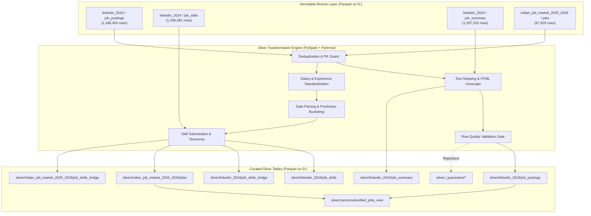
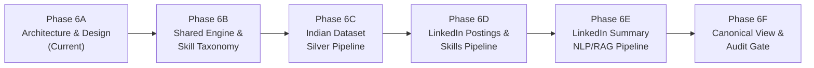

# DemandLens: Medallion Silver Layer Architectural Specification & Transformation Design

**Document Version:** 1.0.0  
**Phase:** Phase 6A — Silver Layer Design & Planning  
**Status:** PROPOSED & READY FOR REVIEW  
**Author:** DemandLens Engineering Team  
**Scope:** Transformation Design for Bronze-to-Silver Pipeline on `D:\DemandLens`  

---

## 1. Executive Summary & Vision

The **Silver Layer** in the DemandLens Medallion Architecture serves as the **Curated, Cleaned, Standardized, and Validated Enterprise Repository** for job-market intelligence. 

While the **Bronze Layer** acts as the immutable, high-fidelity landing zone preserving raw schemas and values across 4,040,096 records (3.17 GB Parquet), it contains structural variance, unparsed string fields, embedded formatting artifacts, missing categorical attributes, and platform-specific representations.

The Silver Layer transforms this raw data into **query-ready, typed, and analytics-optimized datasets** while enforcing five core architectural pillars:
1. **Zero Destructive Mutation of Bronze:** Bronze datasets remain completely read-only and immutable.
2. **Explicit Provenance Retention:** Every Silver record retains complete traceability back to source files and Bronze run IDs.
3. **Domain-Specific Cleaning Without Premature Denormalization:** Large text descriptions (such as the 2.62 GB `job_summary` table) are kept logically separated from analytical dimension tables to prevent query performance degradation.
4. **Strict Rejection & Quarantine Protocol:** Records violating foundational structural invariants (e.g. malformed primary keys or empty titles) are routed to an isolated quarantine layer rather than silently dropped or force-fitted.
5. **Principled Cross-Market Guardrails:** Normalization provides a bridge for observational comparison between LinkedIn 2024 and Indian 2025–2026 data without making scientifically invalid claims of direct equivalence.

---

## 2. High-Level Silver Architecture & Storage Layout

### 2.1 Storage Layout on `D:\DemandLens`
All Silver layer outputs and staging areas reside strictly on the `D:` drive.

```
D:\DemandLens\data\silver\
├── linkedin_2024\
│   ├── job_postings\               # Standardized tabular job postings (~120 MB Parquet)
│   ├── job_skills\                 # Standardized skills array per posting (~140 MB Parquet)
│   ├── job_skills_bridge\          # Exploded (job_link, normalized_skill) indexing table (~80 MB Parquet)
│   ├── job_summary\                # Cleaned, stripped descriptions with NLP/RAG metrics (~1.2 GB Parquet)
│   └── _metadata\                  # Transformation manifests & quality audit logs
│
├── indian_job_market_2025_2026\
│   ├── jobs\                       # Standardized, typed Indian job postings (~35 MB Parquet)
│   ├── job_skills_bridge\          # Exploded (job_id, normalized_skill) indexing table (~15 MB Parquet)
│   └── _metadata\                  # Transformation manifests & quality audit logs
│
├── canonical\
│   ├── unified_jobs_view\          # Lightweight conformed view/schema mapping for cross-market analytics
│   └── _metadata\
│
└── _quarantine\
    ├── linkedin_postings_rejected\ # Records failing primary key or structural validation
    └── indian_jobs_rejected\       # Records failing primary key or structural validation
```

### 2.2 Data Flow Architecture



---

## 3. Dataset Cleaning Rules: LinkedIn Jobs & Skills 2024

### 3.1 `job_postings` Cleaning & Transformation Specification

The raw `job_postings` table contains 1,348,454 rows with 14 original columns.

#### 1. Duplicate Handling
- **Primary Key:** `job_link` (URL string).
- **Rule:** Deduplicate partitioned by `job_link`, ordering by `_ingestion_timestamp DESC` (if ties occur, select the row with the fewest null fields).
- **Baseline Evidence:** Profiled duplicate key count is exactly **18 rows**. Silver row count target after deduplication: **1,348,436 rows**.

#### 2. Null & Missing Value Standardization
- `job_title`: Mandatory. 0 nulls present. Whitespace-trimmed, collapsed spaces.
- `company`: 11 nulls, 0 empty strings. Fill missing with standardized literal `"Unknown Company"`.
- `job_location`: 19 nulls. Fill missing with `"Unknown Location"`.
- `search_country`: 0 nulls. Trimmed and standard casing (`"United States"`, `"United Kingdom"`, `"Canada"`, `"Australia"`).
- `search_city`: Standardize empty strings and nulls to `"Unspecified"`.
- `search_position`: Standardize empty strings and nulls to `"Unspecified"`.
- `job_level`: Contains missing values. Standardize missing/unspecified entries to `"Unspecified"`.
- `job_type`: Contains missing values. Standardize to `"Unspecified"`.

#### 3. Categorical Seniority Harmonization
Map `job_level` into standardized enterprise seniority tiers:
- `"Internship"` $\rightarrow$ `INTERNSHIP`
- `"Entry level"` $\rightarrow$ `ENTRY`
- `"Associate"` $\rightarrow$ `ASSOCIATE_MID`
- `"Mid-Senior level"` $\rightarrow$ `MID_SENIOR`
- `"Director"` $\rightarrow$ `DIRECTOR`
- `"Executive"` $\rightarrow$ `EXECUTIVE`
- `NULL` / `"Not Applicable"` / Others $\rightarrow$ `UNSPECIFIED`

#### 4. Geographic & Remote Flag Extraction
- `is_remote` (`BooleanType`): Set to `TRUE` if `job_location` contains `"Remote"`, `"Hybrid"`, or `"Anywhere"`, else `FALSE`.
- `country_code`: Standardize `search_country` to ISO alpha-2 codes (`"US"`, `"GB"`, `"CA"`, `"AU"`, `"IN"`, `"OTHER"`).
- `location_clean`: Standardized string stripping postal noise and trailing commas.

#### 5. Date & Temporal Standardization
- `first_seen`: Parsed from `YYYY-MM-DD` string to PySpark `DateType`.
- `last_processed_time`: Parsed from ISO timestamp string to PySpark `TimestampType`.

#### 6. Salary Handling
- **Mandatory Constraint:** LinkedIn 2024 contains **zero** structured numerical salary columns.
- Silver fields `salary_min_annual`, `salary_max_annual`, and `salary_currency` must be explicitly populated with `NULL`. Never substitute `$0` or fabricated values.

#### 7. Rejection & Quarantine Criteria
Route to `silver/_quarantine/linkedin_postings_rejected` if:
- `job_link` IS NULL or trimmed length < 10.
- `job_title` IS NULL or trimmed length == 0.

---

### 3.2 `job_skills` Cleaning & Skill Taxonomy Normalization

The raw `job_skills` table contains 1,296,381 rows with 2 columns (`job_link`, `job_skills`).

#### 1. Duplicate & Relational Linkage
- Deduplicate by `job_link` (1 row per job posting).
- Profiled duplicates: **18 rows**. Target unique keys: **1,296,363 rows**.

#### 2. Null Handling & Array Conversion
- 2,007 rows contain null `job_skills`.
- Represent missing skills as an empty native Spark array `[]` (`ArrayType(StringType())`) and flag `has_skills = FALSE`.
- Populate `raw_skill_count = 0` for these rows.

#### 3. Skill Preprocessing Pipeline
For all non-empty `job_skills`:
1. **Token Splitting:** Split comma-delimited strings using regex `\s*,\s*`.
2. **Trimming & Cleaning:** Strip surrounding whitespace, leading/trailing punctuation, quotes, and bullet symbols.
3. **Lowercasing:** Standardize all raw tokens to lowercase for taxonomy matching.
4. **Intra-Posting Deduplication:** Eliminate redundant duplicate tokens within a single job (e.g. `["Python", "python", "Python Programming"]` $\rightarrow$ `["python"]`).

#### 4. Canonical Skill Taxonomy Mapping
Apply an explicit, auditable dictionary mapping common variants into canonical industry tokens:
- `{"python3", "python programming", "python script", "python"}` $\rightarrow$ `"Python"`
- `{"pyspark", "apache spark", "spark sql", "spark"}` $\rightarrow$ `"Apache Spark"`
- `{"aws", "amazon web services", "amazon ec2", "aws cloud"}` $\rightarrow$ `"AWS"`
- `{"gcp", "google cloud platform", "google cloud"}` $\rightarrow$ `"Google Cloud Platform"`
- `{"azure", "microsoft azure"}` $\rightarrow$ `"Microsoft Azure"`
- `{"postgresql", "postgres", "postgre sql"}` $\rightarrow$ `"PostgreSQL"`
- `{"react.js", "reactjs", "react"}` $\rightarrow$ `"React"`
- `{"node.js", "nodejs", "node"}` $\rightarrow$ `"Node.js"`
- `{"docker container", "docker"}` $\rightarrow$ `"Docker"`
- `{"kubernetes", "k8s"}` $\rightarrow$ `"Kubernetes"`
- `{"machine learning", "ml"}` $\rightarrow$ `"Machine Learning"`
- `{"artificial intelligence", "ai"}` $\rightarrow$ `"Artificial Intelligence"`
- *Unmatched tokens:* Title-cased and retained as-is (never dropped).

#### 5. Output Representations
Produce two complementary Silver outputs:
1. **`silver/linkedin_2024/job_skills`:** Contains (`job_link`, `skills_raw_array`, `skills_normalized_array`, `skill_count`, `has_skills`, metadata).
2. **`silver/linkedin_2024/job_skills_bridge`:** Exploded relational bridge table (`job_link`, `normalized_skill`, `skill_rank`) enabling instant SQL grouping, counting, and indexing without expensive runtime `explode()` operations.

---

### 3.3 `job_summary` Cleaning & RAG Text Preparation

The raw `job_summary` table contains 1,297,332 rows with 2 columns (`job_link`, `job_summary`), representing 2.62 GB of Parquet storage.

#### 1. Why `job_summary` Must NOT Be Blindly Merged into `job_postings`
* **Architectural Justification:**
  - The analytical dimension `job_postings` is ~125 MB.
  - The text table `job_summary` is 2.62 GB (~21 times larger).
  - Merging text into postings would force every query (role analysis, skill counting, geographic filtering) to scan a bloated 3+ GB table, drastically increasing memory pressure and I/O.
  - **Decision:** Keep `job_summary` as an isolated text table joined via `job_link` on demand, tailored specifically for NLP, search, and RAG embedding.

#### 2. Text Cleansing Protocol
- **HTML Artifact Removal:** Strip HTML tags (`<p>`, `<li>`, `<br>`, `<div>`, `<strong>`, `<span>`) using regex patterns.
- **HTML Entity Decoding:** Unescape entities (`&amp;` $\rightarrow$ `&`, `&quot;` $\rightarrow$ `"`, `&#39;` $\rightarrow$ `'`, `&lt;` $\rightarrow$ `<`, `&gt;` $\rightarrow$ `>`).
- **Whitespace & Linebreak Normalization:** Replace multiple blank lines with double newlines `\n\n`; strip trailing/leading spaces.

#### 3. Derived Text Metrics & Quality Flags
- `char_length` (`IntegerType`): Total character count of cleaned text.
- `word_count` (`IntegerType`): Approximate word count (`size(split(cleaned_text, "\\s+"))`).
- `is_valid_for_rag` (`BooleanType`): Set to `TRUE` if `char_length >= 100` and `word_count >= 20`.
- `is_short_snippet` (`BooleanType`): Set to `TRUE` if `char_length < 100`.

---

## 4. Dataset Cleaning Rules: Indian Job Market Dataset 2025–2026

The raw Indian dataset `jobs` table contains 97,929 rows with 17 original columns.

### 4.1 Primary Key & Duplicate Handling
- **Primary Key:** `jobId` (`StringType`).
- **Empirical Baseline:** Exactly 97,929 unique IDs; 0 duplicates found in Bronze profiling.
- **Rule:** Deduplicate partitioned by `jobId`, keeping latest record. Target Silver rows: **97,929 rows**.

### 4.2 Salary Standardization & Currency Rules
The Indian dataset features rich compensation attributes: `salary`, `minimumSalary`, `maximumSalary`, `currency`.

#### 1. Currency Verification
- Bronze profiling confirmed `currency` is **100.00% `"INR"`**.
- Standardize `salary_currency` to `"INR"`.

#### 2. Numeric Salary Standardization
- `minimumSalary` and `maximumSalary` represent **Annual Compensation in Indian Rupees (INR)**:
  - Example: `minimumSalary = 300000`, `maximumSalary = 600000` corresponds to `3-6 Lacs PA`.
- Cast to `DoubleType`: `salary_min_annual_inr`, `salary_max_annual_inr`.
- **Handling Undisclosed Salaries:**
  - 71% of postings report `"Not disclosed"` in raw text, resulting in null numerical values in 571 rows and `"0"` or null in text fields.
  - **Strict Rule:** Map undisclosed and zero salaries to `NULL`. Never leave `$0` or `₹0`.
- **Derived Metrics:**
  - `salary_midpoint_annual_inr = (salary_min_annual_inr + salary_max_annual_inr) / 2.0`
  - `is_salary_disclosed` (`BooleanType`): `TRUE` if both min and max are non-null and > 0.

#### 3. Outlier & Sanity Guardrails
- Reject or set to null if:
  - `salary_min_annual_inr < 0` or `salary_max_annual_inr < 0`
  - `salary_min_annual_inr > salary_max_annual_inr`
  - `salary_max_annual_inr > 200,000,000` (₹20 Crore PA sanity cap)

---

### 4.3 Experience Range & Seniority Standardization
- `experience`: Raw text string (e.g. `"2-5 Yrs"`, `"Fresher"`, `"0-1 Yrs"`).
- `minimumExperience` & `maximumExperience`: Cast to `DoubleType` (`exp_min_years`, `exp_max_years`).
- Handle nulls (2,105 rows in raw text; 571 in numeric fields).

#### Harmonized Seniority Tier Mapping:
- **`FRESHER_ENTRY`:** `exp_min_years == 0` or `experience` contains `"Fresher"`, `"0-1"`, `"0-2"`.
- **`ASSOCIATE_MID`:** `exp_min_years >= 3` and `exp_min_years <= 5`.
- **`SENIOR`:** `exp_min_years >= 6` and `exp_min_years <= 9`.
- **`LEAD_EXECUTIVE`:** `exp_min_years >= 10`.
- **`UNSPECIFIED`:** `exp_min_years IS NULL`.

---

### 4.4 Date & Posting Freshness Handling
- Raw column `jobUploaded` contains relative textual strings: `"1 Day Ago"`, `"30+ Days Ago"`, `"Few Hours Ago"`.
- **STRICT ARCHITECTURAL DIRECTIVE:**
  > **DO NOT FABRICATE ABSOLUTE CALENDAR DATES from relative text.** Reverse-engineering dates without knowing the precise scraping timestamp creates false longitudinal signals.
- **Deterministic Freshness Categorization:**
  Standardize `jobUploaded` into an analytical categorical dimension: `freshness_tier`:
  - **`FRESH_24H`:** Values matching `"(?i).*(few hours|just now|today|1 day ago).*"`
  - **`RECENT_7D`:** Values matching `"(?i).*([2-6] days ago|1 week ago).*"`
  - **`MODERATE_30D`:** Values matching `"(?i).*([2-4] weeks ago|[1-2][0-9] days ago).*"`
  - **`STALE_30D_PLUS`:** Values matching `"(?i).*(30\+ days ago|month ago).*"`
  - **`UNSPECIFIED`:** Null or unparseable.

---

### 4.5 Skills Tokenization (`tagsAndSkills`)
- Raw text is comma-separated (e.g. `"Sales, Lead Generation, B2B"`).
- 571 rows (0.58%) are null. Map to empty array `[]`.
- Tokenize, trim, lowercase, deduplicate within record, and map to canonical taxonomy (identical to LinkedIn taxonomy).
- Produce both an array column `skills_normalized_array` and a dedicated bridge table `silver/indian_job_market_2025_2026/job_skills_bridge`.

---

### 4.6 Location & Metro Area Standardization
- Raw `location` contains compound strings (e.g. `"Bengaluru, Mumbai, Pune"`, `"New Delhi"`).
- Standardize:
  - `country`: Fixed to literal `"India"`.
  - `primary_metro`: Extract leading city from canonical Indian metro dictionary:
    `{"Bengaluru", "Bangalore"} $\rightarrow$ "Bengaluru"`  
    `{"Mumbai", "Navi Mumbai"} $\rightarrow$ "Mumbai"`  
    `{"Delhi", "New Delhi", "Noida", "Gurgaon", "Gurugram"} $\rightarrow$ "NCR (Delhi/Noida/Gurgaon)"`  
    `{"Hyderabad"} $\rightarrow$ "Hyderabad"`  
    `{"Pune"} $\rightarrow$ "Pune"`  
    `{"Chennai"} $\rightarrow$ "Chennai"`  
    `{"Kolkata"} $\rightarrow$ "Kolkata"`  
    `{"Remote"} $\rightarrow$ "Remote / Work From Home"`  
    *Others:* `"Other Indian Locations"`
  - `is_remote` (`BooleanType`): `TRUE` if `location` contains `"Remote"` or `"Hybrid"`.

---

### 4.7 Ratings & Reviews Standardization
- `ReviewsCount`: 35,252 nulls (36%). Cast to `IntegerType` (`reviews_count`). Nulls preserved as null.
- `AggregateRating`: 35,252 nulls (36%). Cast to `DoubleType` (`aggregate_rating`). Validated within range `[0.0, 5.0]`.

---

## 5. Cross-Source Canonical View & Market Comparison Guardrails

To fulfill DemandLens's mission of comparative intelligence without corrupting underlying data, the Silver layer defines a **Unified Conformed Canonical Schema** (`silver_canonical_jobs`).

### 5.1 Canonical Schema Definition

```sql
CREATE TABLE silver_canonical_jobs (
    canonical_job_id       STRING,      -- Surrogate key: 'LI_' + job_link_hash or 'IND_' + jobId
    source_id              STRING,      -- 'linkedin_2024' or 'indian_job_market_2025_2026'
    platform               STRING,      -- 'LinkedIn' or 'Naukri'
    original_job_id        STRING,      -- job_link or jobId
    job_title              STRING,      -- Raw trimmed title
    standardized_role      STRING,      -- Canonical role family (e.g. 'Data Engineer')
    company_name           STRING,      -- Standardized company name
    country                STRING,      -- 'United States', 'India', 'United Kingdom', etc.
    primary_city           STRING,      -- Extracted metropolitan city
    is_remote              BOOLEAN,     -- Work arrangement flag
    experience_tier        STRING,      -- 'ENTRY', 'ASSOCIATE_MID', 'SENIOR', 'LEAD_EXECUTIVE', 'UNSPECIFIED'
    salary_min_annual      DOUBLE,      -- Annualized in local currency (NULL for LinkedIn)
    salary_max_annual      DOUBLE,      -- Annualized in local currency (NULL for LinkedIn)
    salary_currency        STRING,      -- 'INR' or NULL
    skills_array           ARRAY<STRING>, -- Standardized, taxonomy-mapped skills array
    has_description        BOOLEAN,     -- Whether text description is available
    date_precision         STRING,      -- 'EXACT_CALENDAR_DATE' or 'RELATIVE_FRESHNESS_TIER'
    freshness_tier         STRING,      -- Standardized freshness bucket
    _ingestion_timestamp   TIMESTAMP,   -- Provenance timestamp
    _bronze_run_id         STRING       -- Ingestion batch run ID
);
```

### 5.2 Market Comparison Guardrails & Analytical Caveats

DemandLens must explicitly surface the following seven methodological boundaries in downstream dashboards and RAG outputs:

| Comparison Dimension | Analytical Limitation & Caveat | Guardrail Enforced |
|---|---|---|
| **1. Geographic Mismatch** | LinkedIn is global (US 48%, UK, Canada, Australia); Indian dataset is 100% India. | **Rule:** Cross-market comparisons must provide an "India-to-India" slicer (`search_country = 'India'` or `job_location LIKE '%India%'`) to isolate platform bias from geographic variance. |
| **2. Temporal Divergence** | LinkedIn represents a 2024 snapshot; Indian dataset represents a 2025–2026 snapshot. | **Rule:** Visualizations must explicitly display source date badges (`[2024 Global]` vs `[2025-2026 India]`). Never plot an unbroken time-series trend connecting them. |
| **3. Compensation Asymmetry** | LinkedIn 2024 contains **0% salary data**; Indian dataset contains **~29% numerical salary**. | **Rule:** Cross-dataset salary comparison is strictly prohibited. Compensation analytics must be restricted to internal Indian dataset views with explicit sample size disclosures. |
| **4. Experience Typing** | LinkedIn uses categorical career bands (`job_level`); Indian dataset provides numerical years (`minimumExperience`). | **Rule:** Compare experience only through harmonized categorical seniority tiers (`ENTRY`, `MID`, `SENIOR`, `LEAD`). |
| **5. Platform & Sourcing Bias** | LinkedIn favors multinational enterprises, remote tech, and global roles; Naukri heavily represents domestic Indian IT services, enterprise consultancies, and regional sales. | **Rule:** Frame insights as platform-specific observations (e.g. *"In Indian portal listings..."*) rather than universal macro-economic declarations. |
| **6. Skill Density Variations** | LinkedIn skills were extracted via Kaggle author parser; Naukri skills come from recruiter-tagged keywords. | **Rule:** Compare relative skill prevalence (`% of cohort postings`) rather than raw keyword frequencies. |
| **7. Relative vs. Exact Dates** | LinkedIn has exact `first_seen` dates; Indian data has relative strings (`"1 Day Ago"`). | **Rule:** Never synthesize calendar days from relative text. Analyze Indian posting age only by freshness tiers. |

---

## 6. Data Quality Framework & Validation Gates

Every Silver transformation pipeline must pass an automated validation gate before committing or promoting files from staging.

### 6.1 Validation Rules Matrix

| Category | Check Description | Threshold / Rule | Action on Failure |
|---|---|---|---|
| **Completeness** | Output Row Count vs. Bronze Deduplicated Rows | Exactly 100% match (zero unexplained loss) | Abort pipeline; rollback staging |
| **Uniqueness** | Primary Key Duplication (`job_link`, `jobId`) | 0 duplicate keys allowed in Silver | Abort pipeline; rollback staging |
| **Schema Integrity** | Expected Columns & Data Types | 100% presence of defined schema | Abort pipeline; rollback staging |
| **Provenance** | Traceability Columns (`_source_id`, `_ingestion_timestamp`, `_bronze_run_id`) | 0 nulls across all metadata columns | Abort pipeline; rollback staging |
| **Skill Array Hygiene** | No empty strings, null tokens, or trailing commas in arrays | 100% clean string tokens | Abort pipeline; rollback staging |
| **Salary Sanity** | If disclosed, `salary_min <= salary_max` and `salary_min > 0` | 100% compliance for non-null salaries | Flag & route row to quarantine |
| **Experience Sanity** | If disclosed, `exp_min <= exp_max` and `exp_min >= 0` | 100% compliance for non-null experience | Flag & route row to quarantine |
| **Storage Standard** | Columnar Parquet with Snappy compression | 100% Snappy verification | Abort pipeline; rollback staging |

---

## 7. Proposed Implementation Roadmap

To maintain strict risk management and verifiable milestones, the Silver layer implementation is decomposed into five focused, sequential subphases:



### Detailed Phase Breakdown:

#### Phase 6B: Silver Foundation, Transformation Engine & Normalization Utilities
- **Objective:** Build reusable transformation functions, UDFs, skill taxonomy dictionaries, text cleaners, and unit test suites.
- **Files to Create:**
  - `src/demandlens/transformations/cleaning_rules.py` (text, HTML, whitespace cleaners)
  - `src/demandlens/transformations/skill_normalizer.py` (taxonomy dictionary and array tokenizers)
  - `src/demandlens/transformations/compensation_normalizer.py` (salary casting, currency, bounds)
  - `src/demandlens/transformations/experience_normalizer.py` (seniority tier mapping)
  - `src/demandlens/transformations/silver_transformer.py` (base PySpark Silver pipeline class)
  - `tests/test_silver_cleaning_rules.py` (unit tests covering all normalizers)
- **Risk Level:** Low. Operates strictly in memory; no persistent data written.

#### Phase 6C: Indian Job Market Silver Transformation
- **Objective:** Ingest Bronze `indian_job_market_2025_2026/jobs` (97,929 rows), clean 17 columns, extract salary/experience/freshness, build `jobs` and `job_skills_bridge` Silver tables.
- **Expected Output:**
  - `data/silver/indian_job_market_2025_2026/jobs/` (~35 MB Parquet, 97,929 rows)
  - `data/silver/indian_job_market_2025_2026/job_skills_bridge/` (~15 MB Parquet)
  - Transformation manifest and audit report.
- **Risk Level:** Low. Fast execution (~15 seconds), verified clean primary keys.

#### Phase 6D: LinkedIn Job Postings & Skills Silver Transformation
- **Objective:** Clean `job_postings` (1.348M rows) and `job_skills` (1.296M rows), apply deduplication, seniority mapping, country/remote flags, skill taxonomy, and generate `job_skills_bridge`.
- **Expected Output:**
  - `data/silver/linkedin_2024/job_postings/` (~120 MB Parquet, 1,348,436 rows)
  - `data/silver/linkedin_2024/job_skills/` (~140 MB Parquet, 1,296,363 rows)
  - `data/silver/linkedin_2024/job_skills_bridge/` (~80 MB Parquet)
  - Transformation manifest and audit report.
- **Risk Level:** Medium. Requires partition-safe deduplication and joining without driver memory blowup.

#### Phase 6E: LinkedIn Job Summary NLP & RAG Cleaning
- **Objective:** Clean HTML and formatting artifacts from `job_summary` (1.297M rows, 2.62 GB), calculate length/word metrics, assign `is_valid_for_rag` quality flags, and save to dedicated Silver text table.
- **Expected Output:**
  - `data/silver/linkedin_2024/job_summary/` (~1.2 GB Parquet, 16 partitions)
  - Transformation manifest and audit report.
- **Risk Level:** Medium-High (I/O volume). Bounded-memory streaming with 10,000-row batch writer ensures no OOM.

#### Phase 6F: Unified Canonical Conformed View & Final Silver Layer Audit
- **Objective:** Establish `silver_canonical_jobs` cross-market conformed schema, perform end-to-end regression testing, generate cumulative Silver layer report, and establish the gate for Phase 7 (Gold Layer Analytics).
- **Expected Output:**
  - `docs/reports/silver_layer_audit_report.md`
  - All unit and integration tests passing.
- **Risk Level:** Low. Read-only validation and verification.

---

## 8. Summary Checklist & Governance

| Requirement | Proposed Architecture Strategy | Compliance |
|---|---|---|
| **D: Drive Exclusive Policy** | All silver outputs, temporary storage, and Spark local dirs on `D:` | ✅ Strict Compliance |
| **Bronze Layer Immutability** | Bronze is read-only; zero mutation or overwriting | ✅ Strict Compliance |
| **No Premature Monolithic Joins** | `job_summary` (2.62 GB) kept decoupled from `job_postings` (125 MB) | ✅ Strict Compliance |
| **No Synthetic Absolute Dates** | Relative dates mapped to analytical freshness tiers only | ✅ Strict Compliance |
| **No Zero Substitution for Salary** | Undisclosed compensation mapped to explicit `NULL` | ✅ Strict Compliance |
| **Cross-Market Disclaimers** | 7 explicit statistical boundaries documented | ✅ Strict Compliance |
| **Local Windows Feasibility** | Bounded streaming, 10,000-row batches, Snappy compression | ✅ Strict Compliance |

---
*Architectural specification compiled for Phase 6A review and approval.*
