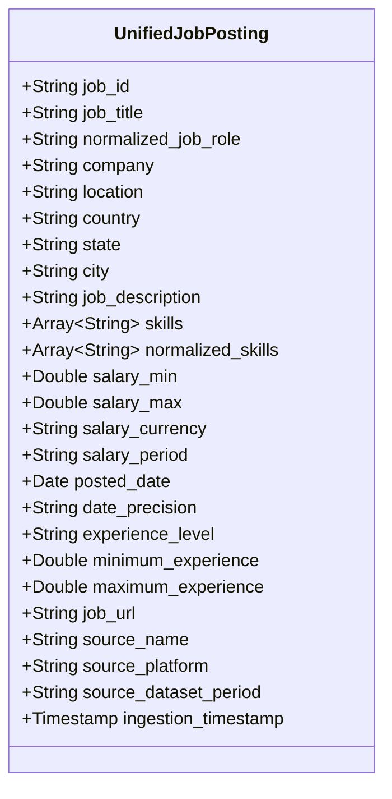

# DemandLens — Market Comparison Feature Design & Common Data Model

This document outlines the architecture, methodology, statistical guardrails, and data contracts for the **Market Comparison** feature of **DemandLens**.

---

## 1. Feature Purpose & Objectives

DemandLens aims to deliver **trustworthy, verifiable job-market intelligence**. A signature capability is the **Market Comparison** engine, which enables users to explore differences and shifts across two distinct job-market snapshots:

1. **Source A (Historical Snapshot):** 1.3M LinkedIn Jobs & Skills (2024, Multi-National / Global emphasis).
2. **Source B (Recent Snapshot):** Indian Job Market Dataset (2025–2026, India / Tech emphasis).

### Core Questions the Feature Answers
- Which technical skills appear most frequently across both platforms?
- What skills have a significantly higher or lower representation (share of postings) between the two snapshots?
- How are experience levels structured across standard job roles?
- When filtering both datasets to India, how do role distributions and skill demands compare?

> [!CAUTION]
> **Strict Non-Equivalence Warning:** These two datasets represent different platforms (LinkedIn vs. Naukri), geographies (Multi-National vs. India), scraping methodologies, and time intervals. DemandLens **must never claim** these datasets constitute an unbroken, scientifically controlled longitudinal time series. All comparisons are **observational, directional, and relative**.

---

## 2. Comparison Accuracy Rules & Ethical Guardrails

To prevent misleading analytics, the engine enforces ten non-negotiable comparison rules:

1. **No Raw Count Comparisons:** Never compare raw record volumes (e.g., 1.3M vs. 97k) as indicators of overall job-market growth or shrinkage.
2. **Relative Prevalence Metric:** Use **percentage share of postings** ($\frac{\text{Postings containing Skill X}}{\text{Total Postings in Cohort with Valid Skills}} \times 100$) as the primary metric.
3. **Mandatory Sample Sizes ($N$):** Every chart, metric card, and comparison table must display the underlying cohort sample size (e.g., *"Skill share: 14.2% ($N=12,450$) vs. 19.8% ($N=84,200$)"*).
4. **Explicit Source & Geography Badging:** Visualizations must clearly display source badges: `[LinkedIn 2024 - Global/Multi-Country]` vs. `[Naukri 2025–2026 - India]`.
5. **No Zero Substitution for Missing Attributes:** If an attribute does not exist in a dataset (e.g., salary in Source A), mark it as **`N/A (Not Collected in Source)`**, never `$0` or `0%`.
6. **No Spurious Time Trends from Relative Dates:** Source B's relative dates (e.g., *"4 Days Ago"*) must never be reverse-engineered into synthetic calendar dates to plot monthly trends.
7. **Strict Field Validation:** Only compare dimensions where schema mapping, data typing, and normalization have been verified.
8. **Apples-to-Apples Geographic Slicing:** When comparing Source B against Source A, provide an option to filter Source A to **`search_country = 'India'`** or **`job_location LIKE '%India%'`** to isolate platform effects from geographic divergence.
9. **No Claims of Universal Market Shifts:** Frame findings with precise attribution (e.g., *"Python appeared in 28% of Indian Naukri postings in 2025–2026 versus 18% of global LinkedIn postings in 2024"* rather than *"Global Python demand increased by 10%"*).
10. **Auditability & Provenance:** The Silver and Gold layers must retain references to the original source-specific values alongside normalized values.

---

## 3. Comparison Feasibility Matrix

| Comparison Dimension | Feasible? | Level of Comparability | Critical Constraints & Requirements |
|---|---|---|---|
| **Skill Prevalence (%)** | **YES** | High (Relative) | Requires skill taxonomy normalization (e.g., mapping `"Python 3"`, `"Python programming"` $\rightarrow$ `"Python"`). |
| **Common vs. Distinct Skills**| **YES** | High | Jaccard overlap and set difference of extracted skills. |
| **Job Role Distribution** | **YES** | Medium | Requires title normalization into standard role families (e.g., Data Engineer, ML Engineer). |
| **Experience Requirements** | **YES** | Medium | Source A uses categorical tiers (`job_level`); Source B uses numerical years (`0-2 Yrs`). Requires mapping years to seniority buckets. |
| **Geographic Distribution** | **PARTIAL** | Conditional | Cannot compare regional volume directly. Meaningful only when comparing city-level distributions within India. |
| **Salary / Compensation** | **NO** (Cross-Dataset) | **Infeasible** | **Source A contains zero salary fields.** Cross-dataset salary comparisons are strictly prohibited. Salary analysis is restricted to Source B internally. |
| **Time-Series / Monthly Trends**| **NO** | **Infeasible** | Source B uses relative unanchored dates (`"30+ Days Ago"`). Accurate time-series line charts cannot be constructed. |

---

## 4. Normalization Methodologies

### 4.1 Skill Normalization Strategy
Raw skill tags in both datasets suffer from casing variance, punctuation differences, and vendor-specific prefixes.

1. **Preprocessing Pipeline:**
   - Lowercase and trim: `strip()`, `lower()`.
   - Strip punctuation: remove trailing dots, slashes, and redundant parenthesis.
   - De-duplicate within a single posting: a posting listing `"Python"` and `"Python 3"` yields a single normalized skill `"python"`.
2. **Canonical Mapping Dictionary (Taxonomy):**
   - `"python3"`, `"python programming"`, `"python script"` $\rightarrow$ `"Python"`
   - `"pyspark"`, `"apache spark"`, `"spark sql"` $\rightarrow$ `"Apache Spark"`
   - `"aws"`, `"amazon web services"` $\rightarrow$ `"AWS"`
   - `"postgre sql"`, `"postgresql"`, `"postgres"` $\rightarrow$ `"PostgreSQL"`
   - `"react.js"`, `"reactjs"`, `"react"` $\rightarrow$ `"React"`
3. **Safety Constraint:** Unrelated skills must never be merged. If a skill does not have a high-confidence mapping, retain its cleaned title-cased token.

### 4.2 Job-Role Normalization Strategy
Job titles in raw postings contain marketing fluff (e.g., `"Rockstar Senior Data Engineer - Urgent Hiring!"`).

1. **Preservation:** The Bronze table preserves the exact raw string in `job_title`.
2. **Rule-Based Canonical Role Extraction:**
   - Matches keywords to a structured taxonomy of standard tech/business roles:
     - *Data Engineering:* Data Engineer, Big Data Engineer, Analytics Engineer, ETL Developer.
     - *Data Science & AI:* Data Scientist, Machine Learning Engineer, AI Engineer, NLP Specialist.
     - *Software Development:* Backend Developer, Frontend Developer, Full Stack Developer, Mobile Developer.
     - *DevOps & Cloud:* DevOps Engineer, Cloud Architect, Site Reliability Engineer (SRE).
     - *Business & Management:* Product Manager, Business Analyst, Project Manager, Scrum Master.
3. **Seniority Flagging:** Strip seniority prefixes from `normalized_job_role` and store them in `experience_level` (e.g., title `"Lead Data Engineer"` $\rightarrow$ Role: `"Data Engineer"`, Seniority: `"Lead/Staff"`).

### 4.3 Experience Level Harmonization

| Normalized Tier | Definition | Source A Mapping (`job_level`) | Source B Mapping (`minimumExperience` / `experience`) |
|---|---|---|---|
| **Entry / Fresher** | 0 to 2 years | `"Entry level"`, `"Internship"` | `min_exp == 0` or text contains `"fresher"`, `"0-1"`, `"0-2"` |
| **Associate / Mid** | 3 to 5 years | `"Associate"`, `"Mid-Senior level"` (lower band) | `min_exp` between 3 and 5 years |
| **Senior** | 6 to 9 years | `"Mid-Senior level"` (upper band) | `min_exp` between 6 and 9 years |
| **Lead / Staff / Principal**| 10+ years | `"Director"`, `"Executive"` | `min_exp >= 10` years |
| **Not Disclosed** | Missing / Unknown | Null, `"Not Applicable"` | Null or unparseable |

### 4.4 Salary Harmonization (Source B Internal)
1. **Currency Normalization:** Ensure currency is standardized to Indian Rupees (`INR`).
2. **Unit Conversion:** Indian listings commonly quote in *Lakhs Per Annum (LPA)*. Convert all values to annual figures in INR:
   $$\text{Annual Salary (INR)} = \text{Value in LPA} \times 100,000$$
3. **Filtering:** Exclude listings where salary is marked `"Not Disclosed"` from mean/median/distribution statistics.

---

## 5. Common Job-Posting Data Model (Silver Schema)

The unified schema standardizes fields across all sources while preserving source provenance.

### Detailed Field Specification

| Field Name | Data Type | Nullable | Source A Mapping | Source B Mapping | Handling & Normalization Rules |
|---|---|---|---|---|---|
| `job_id` | `StringType` | No | Hash of `job_link` or sanitized URL | `jobId` or hash of `company+title+location` | Unique surrogate key formatted as `{source_code}_{hash}`. |
| `job_title` | `StringType` | No | `job_title` | `title` | Trimmed, whitespace-collapsed original title. |
| `normalized_job_role` | `StringType` | Yes | Derived from `job_title` | Derived from `title` | Mapped against canonical role taxonomy. Default: `"Other / Unclassified"`. |
| `company` | `StringType` | Yes | `company` | `companyName` | Cleaned company name, stripped of legal entities (Inc, Ltd, LLC). |
| `location` | `StringType` | Yes | `job_location` | `location` | Raw concatenated location string. |
| `country` | `StringType` | Yes | `search_country` or parsed from `job_location` | Fixed to `"India"` (or parsed if remote) | ISO 3166 alpha-2 or standard English country name. |
| `state` | `StringType` | Yes | Parsed from `job_location` | Parsed from `location` (e.g., Karnataka, Maharashtra) | Standard state/province name. |
| `city` | `StringType` | Yes | `search_city` or parsed from `job_location` | Parsed from `location` (e.g., Bengaluru, Mumbai) | Cleaned municipality name. |
| `job_description` | `StringType` | Yes | `job_summary` (from `job_summary.csv`) | Null / Not Available | Full body text. Stripped of HTML tags if present. |
| `skills` | `ArrayType(StringType)` | Yes | Split `job_skills` by comma | Split `tagsAndSkills` by delimiter | Array of raw skill tokens. Empty array if null. |
| `normalized_skills` | `ArrayType(StringType)` | Yes | Normalized tokens from `job_skills` | Normalized tokens from `tagsAndSkills` | Lowercased, taxonomy-mapped, de-duplicated array. |
| `salary_min` | `DoubleType` | Yes | Fixed `null` | `minimumSalary` | Normalized to annual INR figure. Null if not disclosed. |
| `salary_max` | `DoubleType` | Yes | Fixed `null` | `maximumSalary` | Normalized to annual INR figure. Null if not disclosed. |
| `salary_currency` | `StringType` | Yes | Fixed `null` | `currency` or `"INR"` | Standard 3-letter currency code (e.g., `"INR"`, `"USD"`). |
| `salary_period` | `StringType` | Yes | Fixed `null` | `"ANNUAL"` | Standardized period: `"ANNUAL"`, `"MONTHLY"`, `"HOURLY"`. |
| `posted_date` | `DateType` | Yes | `first_seen` (parsed `YYYY-MM-DD`) | `null` (or scraping date if verified) | Valid date or null if only relative dates are available. |
| `date_precision` | `StringType` | No | `"EXACT_DATE"` | `"RELATIVE_ESTIMATE"` or `"UNKNOWN"` | Indicates temporal reliability of `posted_date`. |
| `experience_level` | `StringType` | Yes | `job_level` mapped to standard tier | Mapped from `experience` / `minimumExperience` | Standard tiers: `"Entry"`, `"Mid"`, `"Senior"`, `"Lead"`, `"Unknown"`. |
| `minimum_experience` | `DoubleType` | Yes | Inferred from `job_level` (approximate) | `minimumExperience` | Numeric lower bound in years (e.g., `3.0`). |
| `maximum_experience` | `DoubleType` | Yes | Inferred from `job_level` (approximate) | `maximumExperience` | Numeric upper bound in years (e.g., `6.0`). |
| `job_url` | `StringType` | Yes | `job_link` | Null (or portal search URL) | Web link to original posting for auditing and citations. |
| `source_name` | `StringType` | No | `"linkedin_jobs_2024"` | `"indian_job_market_2025_2026"` | Canonical dataset identifier. |
| `source_platform` | `StringType` | No | `"LinkedIn"` | `"Naukri"` | Underlying origin platform. |
| `source_dataset_period`| `StringType` | No | `"2024"` | `"2025-2026"` | High-level temporal cohort badge. |
| `ingestion_timestamp` | `TimestampType` | No | Current UTC timestamp at ingestion | Current UTC timestamp at ingestion | Pipeline audit tracking. |

---

## 6. Suggested Dashboard Visualizations & Filtering Controls

### 6.1 Interactive Filter Hierarchy
- **Primary Cohort Selectors:**
  - `Dataset Selection:` [Dataset A: LinkedIn 2024] / [Dataset B: India 2025–2026] / [Both (Side-by-Side Comparison)]
  - `Geographic Scope:` [All Available] / [India Only (Apples-to-Apples Geo Filter)] / [United States Only]
- **Dimension Slicers:**
  - `Normalized Job Role:` Multi-select dropdown (e.g., "Data Engineer", "Machine Learning Engineer").
  - `Experience Tier:` Multi-select (Entry, Mid, Senior, Lead).
  - `Skill Focus:` Typeahead search for comparing specific technologies (e.g., "PySpark" vs "Snowflake").

### 6.2 Key Comparison Charts
1. **Top 20 Skills Comparison (Diverging Horizontal Bar Chart):**
   - Displays percentage share of postings for the top skills in each cohort side-by-side with $N$ counts.
2. **Skill Differential Leaderboard:**
   - Highlights skills with the highest positive and negative delta in representation percentage.
3. **Role Distribution Breakdown (Grouped Bar Chart):**
   - Compares the composition of engineering, science, and analytics roles across both sources.
4. **Experience Level Composition (Stacked Percentage Bar):**
   - Visualizes the proportion of Entry vs. Mid vs. Senior postings per role in each snapshot.
5. **Salary Distribution by Role (Single Source Card - Source B Only):**
   - Box plots and median salary indicators strictly for Source B, with explicit disclaimer: *"Salary metrics represent Indian market data from Source B only. Source A does not contain compensation figures."*

