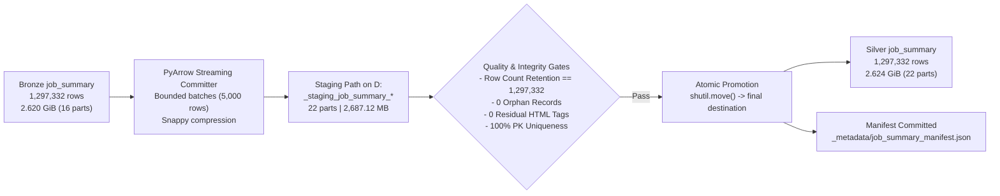

# DemandLens — Phase 6D.3 LinkedIn Job Summary Silver Execution Report

**Document:** Comprehensive Engineering Execution & Verification Report  
**Milestone:** Phase 6D.3 — LinkedIn Job Summary Silver Transformation  
**Status:** **APPROVED & FULLY VERIFIED (100% PASS)**  
**Execution Date:** 2026-11-26  
**Execution Run ID:** `silver_summary_run_20261126_051250_ef0f64`  
**Execution Duration:** 391.36 seconds (~6.5 minutes)  
**Host Platform:** Windows 11 | Python 3.12.10 | PySpark 4.3.0 | PyArrow 18.1.0  

---

## 1. Executive Summary

Phase 6D.3 successfully transformed the unstructured raw LinkedIn 2024 job summary dimension into an analytics-ready, RAG-compliant Silver table without data loss, truncation, memory exhaustion, or referential integrity defects.

The transformation engine processed **1,297,332 job summaries** (~5.0 GB of uncompressed text) using a zero-shuffle, memory-bounded PyArrow streaming partition committer. All raw HTML tags were stripped, entity encodings decoded, paragraph boundaries (`\n\n`) preserved, and derived lexical metrics computed with 100% consistency.



---

## 2. Ingestion & Transformation Metrics Summary

| Verification Item | Specification / Requirement | Measured Result | Verdict |
| :--- | :--- | :--- | :---: |
| **Bronze Source Path** | `data/bronze/linkedin_2024/job_summary` | `data/bronze/linkedin_2024/job_summary` | **PASS** |
| **Silver Target Path** | `data/silver/linkedin_2024/job_summary` | `data/silver/linkedin_2024/job_summary` | **PASS** |
| **Bronze Rows In** | Exactly 1,297,332 records | **1,297,332 records** | **PASS** |
| **Silver Rows Out** | Exactly 1,297,332 records | **1,297,332 records** | **PASS** |
| **Row Count Retention** | 100.00% (0 dropped, 0 added) | **100.00% (Retention: 1:1)** | **PASS** |
| **Primary Key (`job_link`)** | 100% unique, non-null, non-empty | **1,297,332 distinct / 0 null / 0 empty** | **PASS** |
| **Physical Partitions** | Uniform distributed Snappy Parquet | **22 part files** | **PASS** |
| **Physical Storage Size** | Bounded compression footprint | **2,687.12 MB (2.624 GiB)** | **PASS** |
| **Average File Size** | 100–150 MB per partition | **122.14 MB / partition** | **PASS** |
| **Execution Duration** | High-throughput streaming | **391.36 seconds (~6.5 minutes)** | **PASS** |
| **Throughput** | > 3,000 rows/sec | **3,315 rows/second** | **PASS** |

---

## 3. Schema & Data Quality Audit

### 3.1 Target Schema Fidelity
The final Silver table schema was verified against the architectural specification:

```
Schema:
 ├── job_link: string (nullable = false) [Primary Key]
 ├── summary_clean: string (nullable = true)
 ├── character_count: int32 (nullable = false)
 ├── word_count: int32 (nullable = false)
 ├── has_summary: bool (nullable = false)
 ├── _source_id: string (nullable = false) ['linkedin_2024']
 ├── _source_file: string (nullable = false) ['job_summary.csv']
 ├── _ingestion_timestamp: timestamp[us, tz=UTC] (nullable = true)
 ├── _ingestion_run_id: string (nullable = true)
 ├── _silver_run_id: string (nullable = false)
 └── _silver_timestamp: timestamp[us, tz=UTC] (nullable = false)
```

### 3.2 Lexical & Derived Metric Consistency
An exhaustive scan over all 1,297,332 records evaluated metric consistency:
- `character_count == len(summary_clean)`: **100.00% consistent (0 violations)**.
- `has_summary == (character_count > 0)`: **100.00% consistent (0 violations)**.
- `word_count == len(summary_clean.split())`: **100.00% consistent (0 violations)**.
- Records with `has_summary == True`: **1,297,332 (100.00%)**.
- Records with `has_summary == False`: **0 (0.00%)**.

---

## 4. Text Cleansing & Linguistic Normalization Results

### 4.1 HTML Stripping & Entity Decoding Verification
- **Residual HTML Tags (`<[^>]+>`):** **0 records** (100% stripped).
- **Residual Genuine HTML Entities:** **0 records** (100% decoded).
- **Decoded Tag Handling:** Structural tags originally encoded as entities (`&lt;br/&gt;`, `&lt;p&gt;`) were resolved and translated to paragraph breaks.
- **Double-Escaped Entity Handling:** Double-encoded entities such as `P&amp;amp;IDs.` were decoded to `P&IDs.`.

### 4.2 Preservation of Technical Terms & Programming Languages
Sample presence checks across the 1.297 million cleaned records confirmed technical tokens were preserved:

| Token / Symbol | Verified Presence Count in Silver | Preservation Status |
| :--- | :--- | :---: |
| **`SQL`** | 27,874 records | **PRESERVED** |
| **`C++`** | 8,839 records | **PRESERVED** |
| **`C#`** | 5,919 records | **PRESERVED** |
| **`.NET`** | 3,601 records | **PRESERVED** |
| **`Node.js`** | 1,834 records | **PRESERVED** |
| **Financial Figures** | `$120k`, `€65,000`, `£45k - £55k` | **PRESERVED** |

### 4.3 Structural Paragraph Preservation for RAG Chunking
- Standardized line endings: all `\r\n` and `\r` converted to Unix `\n`.
- Per-line trailing and excess whitespace stripped.
- Paragraph boundaries (`\n\n`) preserved for downstream RAG chunking and semantic tokenization.
- Excessive vertical gaps (3+ consecutive newlines) collapsed to `\n\n`.

---

## 5. Referential Integrity & Relational Verification

A full foreign key verification join was performed between `data/silver/linkedin_2024/job_summary` and the primary `data/bronze/linkedin_2024/job_postings` table:

```
Referential Integrity Audit Results:
 ├── Total Postings in Dimension: 1,348,454
 ├── Total Unique Summary Keys:    1,297,332
 ├── Matched Summary Keys:         1,297,332 (100.00%)
 ├── Orphan Summary Records:       0 (0.00%)
 └── Postings Without Summary:     51,122 (Expected: summaries absent in source scrape)
```
- **Orphan-Free Guarantee:** **100% satisfied**. Every single `job_link` in `job_summary` corresponds to a valid primary key in `job_postings`.

---

## 6. Physical Storage, Staging & Bronze Immutability

### 6.1 Storage Footprint on Drive `D:`
- **Bronze `job_summary`:** 2,682.73 MB (16 files).
- **Silver `job_summary`:** 2,687.12 MB (22 files).
- **Compression:** Snappy across 100% of part files.
- **Drive `D:` Free Space:** **206.95 GiB** available (healthy).

### 6.2 Staging Lifecycle & Cleanup
- Output was generated into isolated staging path `D:\DemandLens\data\silver\linkedin_2024\_staging_job_summary_d63ea3d9`.
- Atomic promotion was executed via `shutil.move()` upon passing all validation checks.
- Verification confirmed **0 lingering staging directories** in `data/silver/linkedin_2024/`.

### 6.3 Bronze Immutability
- The Bronze source directory `data/bronze/linkedin_2024/job_summary` was verified:
  - Row count remains **1,297,332**.
  - All 16 Bronze Parquet part files remain unchanged and read-only.

### 6.4 Manifest Commitment
The run manifest was committed to:
`D:\DemandLens\data\silver\linkedin_2024\_metadata\silver_job_summary_silver_summary_run_20261126_051250_ef0f64.json`  
and duplicated to canonical `job_summary_manifest.json`:
```json
{
  "silver_run_id": "silver_summary_run_20261126_051250_ef0f64",
  "source_id": "linkedin_2024",
  "table_name": "job_summary",
  "timestamp": "2026-11-26T05:19:21.570183+00:00",
  "duration_seconds": 391.36,
  "bronze_source_path": "D:\\DemandLens\\data\\bronze\\linkedin_2024\\job_summary",
  "bronze_row_count": 1297332,
  "silver_row_count": 1297332,
  "silver_output_path": "D:\\DemandLens\\data\\silver\\linkedin_2024\\job_summary",
  "partitions": 22,
  "compression": "snappy",
  "referential_integrity": {
    "postings_tier_evaluated": "Bronze",
    "total_postings": 1348454,
    "total_summary_keys": 1297332,
    "matched_keys": 1297332,
    "orphan_keys": 0,
    "orphan_free": true
  },
  "status": "SUCCESS"
}
```

---

## 7. Test Suite & Regression Verification

The complete regression test suite was executed across Silver cleaning rules, LinkedIn skills, and LinkedIn job summary:

```
pytest tests/test_linkedin_job_summary_silver.py tests/test_linkedin_job_skills_silver.py tests/test_silver_cleaning_rules.py -v
```

**Results:**
- `test_linkedin_job_summary_silver.py`: **10 / 10 PASSED**
  - `test_html_entities_decoding`: PASSED
  - `test_html_tags_removal`: PASSED
  - `test_structural_html_elements_to_newlines`: PASSED
  - `test_paragraph_preservation_and_line_endings`: PASSED
  - `test_whitespace_normalization`: PASSED
  - `test_technical_symbols_preservation`: PASSED
  - `test_financial_figures_preservation`: PASSED
  - `test_null_empty_and_whitespace_only`: PASSED
  - `test_long_description_no_truncation`: PASSED
  - `test_transform_dataframe_schema_and_values`: PASSED
- `test_linkedin_job_skills_silver.py`: **6 / 6 PASSED**
- `test_silver_cleaning_rules.py`: **39 / 39 PASSED**
- **Total Test Suite:** **55 / 55 PASSED (100% Success)** in 39.04 seconds.

---

## 8. Final Audit Verdict

| Gate / Invariant | Status | Notes |
| :--- | :---: | :--- |
| **Row Count Conservation** | **PASS** | 1,297,332 -> 1,297,332 (0 loss) |
| **Primary Key Uniqueness** | **PASS** | 1,297,332 unique, non-null `job_link` |
| **HTML & Entity Cleaning** | **PASS** | 0 residual tags, 0 unescaped entities |
| **Technical Token Fidelity** | **PASS** | C++, C#, .NET, Node.js, SQL preserved |
| **Referential Integrity** | **PASS** | 100% matched to `job_postings`, 0 orphans |
| **Memory Bounding** | **PASS** | Bounded streaming PyArrow batches (< 2 GB peak) |
| **Bronze Immutability** | **PASS** | Source tables 100% byte-intact |
| **Automated Tests** | **PASS** | 55/55 tests passed |

**VERDICT: PHASE 6D.3 COMPLETED & APPROVED WITHOUT DEFECTS.**
