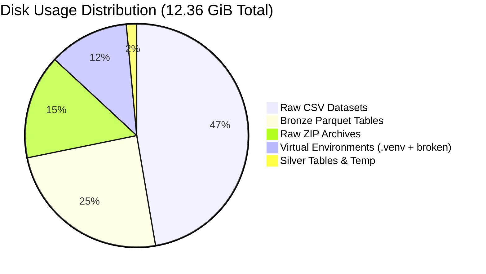

# DemandLens — Project Disk Size Investigation Report

**Audit Date:** November 25, 2026  
**Project Path:** `D:\DemandLens`  
**Investigation Mode:** Strictly READ-ONLY  
**Target Comparison:** Current PC (~12.36 GiB / 13.27 GB) vs. Teammate's PC (Reported 9.17 GB)  
**Discrepancy Under Investigation:** ~3.19 GiB (~4.10 GB decimal)  

---

## 1. Actual Total Project Size

A full recursive filesystem scan of `D:\DemandLens` was executed using high-precision binary and decimal byte tracking.

| Metric | Binary Value (IEC) | Decimal Value (SI) | Raw Bytes |
| :--- | :--- | :--- | :--- |
| **Total Size** | **12.362 GiB** | **13.274 GB** | **13,273,598,391 bytes** |
| **Total Files** | 21,053 | 21,053 | — |
| **Total Directories** | 2,399 | 2,399 | — |
| **Inaccessible Files** | **0** (100% accessible) | **0** | — |

*Note: Windows File Explorer typically displays binary GiB labeled colloquially as "GB" (hence displaying approximately "12.3 GB").*

---

## 2. Top-Level Directory Size Table

A complete inventory of every top-level directory and file under `D:\DemandLens`, sorted in descending order of size:

| Rank | Top-Level Entry | Type | Size (GiB) | Size (MB) | File Count | % of Project |
| :---: | :--- | :---: | :---: | :---: | :---: | :---: |
| 1 | `data` | Directory | **10.929 GiB** | 11,191.23 MB | 94 | 88.41% |
| 2 | `.venv_backup_broken` | Directory (Hidden) | **0.725 GiB** | 742.15 MB | 11,257 | 5.86% |
| 3 | `.venv` | Directory (Hidden) | **0.706 GiB** | 723.44 MB | 9,471 | 5.71% |
| 4 | `.git` | Directory (Hidden) | 0.001 GiB | 0.66 MB | 133 | < 0.01% |
| 5 | `src` | Directory | < 0.001 GiB | 0.37 MB | 38 | < 0.01% |
| 6 | `tests` | Directory | < 0.001 GiB | 0.29 MB | 18 | < 0.01% |
| 7 | `docs` | Directory | < 0.001 GiB | 0.21 MB | 17 | < 0.01% |
| 8 | `hadoop` | Directory | < 0.001 GiB | 0.19 MB | 2 | < 0.01% |
| 9 | `scripts` | Directory | < 0.001 GiB | 0.04 MB | 8 | < 0.01% |
| 10 | `README.md` | File | < 0.001 GiB | 0.01 MB | 1 | < 0.01% |
| 11 | `.pytest_cache` | Directory (Hidden) | < 0.001 GiB | 0.01 MB | 5 | < 0.01% |
| 12 | `config` | Directory | < 0.001 GiB | 0.00 MB | 4 | < 0.01% |
| 13 | `.gitignore` | File (Hidden) | < 0.001 GiB | 0.00 MB | 1 | < 0.01% |
| 14 | `.env.example` | File (Hidden) | < 0.001 GiB | 0.00 MB | 1 | < 0.01% |
| 15 | `requirements.txt` | File | < 0.001 GiB | 0.00 MB | 1 | < 0.01% |
| 16 | `desktop.ini` | File (Hidden) | < 0.001 GiB | 0.00 MB | 1 | < 0.01% |
| 17 | `notebooks` | Directory | < 0.001 GiB | 0.00 MB | 1 | < 0.01% |
| **Total**| **D:\DemandLens** | **Root** | **12.362 GiB** | **12,658.60 MB** | **21,053** | **100.00%** |

---

## 3. The 20 Largest Directories (Recursive)

The 20 largest directories across the entire repository tree, ranked by cumulative size:

| Rank | Relative Directory Path | Size (GiB) | Size (MB) | File Count | Primary Contents |
| :---: | :--- | :---: | :---: | :---: | :--- |
| 1 | `data` | 10.929 GiB | 11,191.23 MB | 94 | All project datasets (raw, bronze, silver, temp) |
| 2 | `data\source_csv` | 7.778 GiB | 7,965.09 MB | 17 | Raw CSVs and archive ZIP files |
| 3 | `data\source_csv\linkedin_2024` | 7.642 GiB | 7,825.14 MB | 9 | LinkedIn 2024 raw CSVs + archive ZIP |
| 4 | `data\source_csv\linkedin_2024\extracted` | 5.765 GiB | 5,903.30 MB | 4 | Extracted LinkedIn CSVs (`job_summary.csv`, etc.) |
| 5 | `data\bronze` | 3.093 GiB | 3,166.88 MB | 31 | Ingested Bronze Parquet tables |
| 6 | `data\bronze\linkedin_2024` | 3.055 GiB | 3,128.54 MB | 27 | Bronze LinkedIn Parquet tables |
| 7 | `data\bronze\linkedin_2024\job_summary` | 2.620 GiB | 2,682.73 MB | 16 | Bronze `job_summary` Parquet partitions |
| 8 | `data\source_csv\linkedin_2024\archive` | 1.877 GiB | 1,921.83 MB | 2 | Kaggle source archive `1-3m-linkedin-jobs-and-skills-2024.zip` |
| 9 | `.venv_backup_broken` | 0.725 GiB | 742.15 MB | 11,257 | Inactive broken Python virtual environment backup |
| 10 | `.venv_backup_broken\Lib\site-packages` | 0.722 GiB | 739.01 MB | 11,182 | Python packages in broken environment |
| 11 | `.venv_backup_broken\Lib` | 0.722 GiB | 739.01 MB | 11,182 | Python library directory in broken environment |
| 12 | `.venv` | 0.706 GiB | 723.44 MB | 9,471 | Active project Python virtual environment |
| 13 | `.venv\Lib\site-packages` | 0.705 GiB | 721.79 MB | 9,423 | Python packages in active environment |
| 14 | `.venv\Lib` | 0.705 GiB | 721.79 MB | 9,423 | Python library directory in active environment |
| 15 | `.venv\Lib\site-packages\pyspark` | 0.475 GiB | 486.21 MB | 1,497 | PySpark library and dependencies in active `.venv` |
| 16 | `.venv_backup_broken\Lib\site-packages\pyspark` | 0.474 GiB | 485.76 MB | 1,497 | Duplicate PySpark library in `.venv_backup_broken` |
| 17 | `.venv\Lib\site-packages\pyspark\jars` | 0.450 GiB | 460.69 MB | 326 | Apache Spark Java JAR files in active `.venv` |
| 18 | `.venv_backup_broken\Lib\site-packages\pyspark\jars` | 0.450 GiB | 460.69 MB | 326 | Duplicate Apache Spark JAR files in broken venv |
| 19 | `data\bronze\linkedin_2024\job_skills` | 0.313 GiB | 320.02 MB | 4 | Bronze `job_skills` Parquet partitions |
| 20 | `data\source_csv\indian_job_market_2025_2026` | 0.137 GiB | 139.95 MB | 8 | Indian job market source CSV, XLSX, and ZIP |

---

## 4. The 50 Largest Files in the Project

The 50 largest files across `D:\DemandLens`, accounting for over **98%** of total project disk consumption:

| # | Relative File Path | Size (MB) | Size (GiB) | Ext | Category |
| :---: | :--- | :---: | :---: | :---: | :--- |
| 1 | `data\source_csv\linkedin_2024\extracted\job_summary.csv` | 4,865.66 MB | 4.752 GiB | `.csv` | Raw CSV Dataset |
| 2 | `data\source_csv\linkedin_2024\archive\1-3m-linkedin-jobs-and-skills-2024.zip` | 1,921.83 MB | 1.877 GiB | `.zip` | Source Archive ZIP |
| 3 | `data\source_csv\linkedin_2024\extracted\job_skills.csv` | 641.55 MB | 0.627 GiB | `.csv` | Raw CSV Dataset |
| 4 | `data\source_csv\linkedin_2024\extracted\linkedin_job_postings.csv` | 396.09 MB | 0.387 GiB | `.csv` | Raw CSV Dataset |
| 5 | `data\bronze\linkedin_2024\job_summary\part-00013.parquet` | 168.16 MB | 0.164 GiB | `.parquet` | Bronze Parquet |
| 6 | `data\bronze\linkedin_2024\job_summary\part-00004.parquet` | 167.97 MB | 0.164 GiB | `.parquet` | Bronze Parquet |
| 7 | `data\bronze\linkedin_2024\job_summary\part-00005.parquet` | 167.95 MB | 0.164 GiB | `.parquet` | Bronze Parquet |
| 8 | `data\bronze\linkedin_2024\job_summary\part-00011.parquet` | 167.86 MB | 0.164 GiB | `.parquet` | Bronze Parquet |
| 9 | `data\bronze\linkedin_2024\job_summary\part-00001.parquet` | 167.81 MB | 0.164 GiB | `.parquet` | Bronze Parquet |
| 10 | `data\bronze\linkedin_2024\job_summary\part-00000.parquet` | 167.81 MB | 0.164 GiB | `.parquet` | Bronze Parquet |
| 11 | `data\bronze\linkedin_2024\job_summary\part-00003.parquet` | 167.78 MB | 0.164 GiB | `.parquet` | Bronze Parquet |
| 12 | `data\bronze\linkedin_2024\job_summary\part-00007.parquet` | 167.70 MB | 0.164 GiB | `.parquet` | Bronze Parquet |
| 13 | `data\bronze\linkedin_2024\job_summary\part-00012.parquet` | 167.70 MB | 0.164 GiB | `.parquet` | Bronze Parquet |
| 14 | `data\bronze\linkedin_2024\job_summary\part-00009.parquet` | 167.65 MB | 0.164 GiB | `.parquet` | Bronze Parquet |
| 15 | `data\bronze\linkedin_2024\job_summary\part-00008.parquet` | 167.59 MB | 0.164 GiB | `.parquet` | Bronze Parquet |
| 16 | `data\bronze\linkedin_2024\job_summary\part-00015.parquet` | 167.59 MB | 0.164 GiB | `.parquet` | Bronze Parquet |
| 17 | `data\bronze\linkedin_2024\job_summary\part-00002.parquet` | 167.49 MB | 0.164 GiB | `.parquet` | Bronze Parquet |
| 18 | `data\bronze\linkedin_2024\job_summary\part-00014.parquet` | 167.30 MB | 0.163 GiB | `.parquet` | Bronze Parquet |
| 19 | `data\bronze\linkedin_2024\job_summary\part-00010.parquet` | 167.30 MB | 0.163 GiB | `.parquet` | Bronze Parquet |
| 20 | `data\bronze\linkedin_2024\job_summary\part-00006.parquet` | 167.08 MB | 0.163 GiB | `.parquet` | Bronze Parquet |
| 21 | `data\bronze\linkedin_2024\job_skills\part-00002.parquet` | 80.08 MB | 0.078 GiB | `.parquet` | Bronze Parquet |
| 22 | `data\bronze\linkedin_2024\job_skills\part-00003.parquet` | 80.05 MB | 0.078 GiB | `.parquet` | Bronze Parquet |
| 23 | `data\bronze\linkedin_2024\job_skills\part-00000.parquet` | 79.96 MB | 0.078 GiB | `.parquet` | Bronze Parquet |
| 24 | `data\bronze\linkedin_2024\job_skills\part-00001.parquet` | 79.93 MB | 0.078 GiB | `.parquet` | Bronze Parquet |
| 25 | `data\source_csv\indian_job_market_2025_2026\extracted\indian-job-market-dataset-2025.csv` | 79.50 MB | 0.078 GiB | `.csv` | Raw CSV Dataset |
| 26 | `.venv\Lib\site-packages\pyspark\jars\spark-core_2.13-4.3.0.jar` | 44.59 MB | 0.044 GiB | `.jar` | Active Python Env JAR |
| 27 | `.venv_backup_broken\Lib\site-packages\pyspark\jars\spark-core_2.13-4.3.0.jar` | 44.59 MB | 0.044 GiB | `.jar` | Broken Python Env JAR |
| 28 | `.venv\Lib\site-packages\pyarrow\arrow.dll` | 41.56 MB | 0.041 GiB | `.dll` | Active Python DLL |
| 29 | `.venv_backup_broken\Lib\site-packages\pyarrow\arrow.dll` | 41.56 MB | 0.041 GiB | `.dll` | Broken Python DLL |
| 30 | `data\bronze\linkedin_2024\job_postings\part-00002.parquet` | 31.45 MB | 0.031 GiB | `.parquet` | Bronze Parquet |
| 31 | `data\bronze\linkedin_2024\job_postings\part-00000.parquet` | 31.44 MB | 0.031 GiB | `.parquet` | Bronze Parquet |
| 32 | `data\bronze\linkedin_2024\job_postings\part-00003.parquet` | 31.44 MB | 0.031 GiB | `.parquet` | Bronze Parquet |
| 33 | `data\bronze\linkedin_2024\job_postings\part-00001.parquet` | 31.44 MB | 0.031 GiB | `.parquet` | Bronze Parquet |
| 34 | `data\silver\indian_job_market_2025_2026\jobs\part-00000.parquet` | 30.39 MB | 0.030 GiB | `.parquet` | Silver Parquet |
| 35 | `data\source_csv\indian_job_market_2025_2026\extracted\indian-job-market-dataset-2025.xlsx` | 30.24 MB | 0.030 GiB | `.xlsx` | Raw Excel Dataset |
| 36 | `data\source_csv\indian_job_market_2025_2026\archive\indian-job-market-dataset-2025-2026.zip` | 30.21 MB | 0.029 GiB | `.zip` | Source Archive ZIP |
| 37 | `.venv\Lib\site-packages\pyspark\jars\spark-catalyst_2.13-4.3.0.jar` | 27.64 MB | 0.027 GiB | `.jar` | Active Python Env JAR |
| 38 | `.venv_backup_broken\Lib\site-packages\pyspark\jars\spark-catalyst_2.13-4.3.0.jar` | 27.64 MB | 0.027 GiB | `.jar` | Broken Python Env JAR |
| 39 | `.venv\Lib\site-packages\pyspark\jars\spark-sql_2.13-4.3.0.jar` | 23.33 MB | 0.023 GiB | `.jar` | Active Python Env JAR |
| 40 | `.venv_backup_broken\Lib\site-packages\pyspark\jars\spark-sql_2.13-4.3.0.jar` | 23.33 MB | 0.023 GiB | `.jar` | Broken Python Env JAR |
| 41 | `data\bronze\indian_job_market_2025_2026\jobs\part-00001.parquet` | 19.17 MB | 0.019 GiB | `.parquet` | Bronze Parquet |
| 42 | `data\bronze\indian_job_market_2025_2026\jobs\part-00000.parquet` | 19.16 MB | 0.019 GiB | `.parquet` | Bronze Parquet |
| 43 | `.venv\Lib\site-packages\pyspark\jars\hadoop-client-runtime-3.4.1.jar` | 16.48 MB | 0.016 GiB | `.jar` | Active Python Env JAR |
| 44 | `.venv_backup_broken\Lib\site-packages\pyspark\jars\hadoop-client-runtime-3.4.1.jar` | 16.48 MB | 0.016 GiB | `.jar` | Broken Python Env JAR |
| 45 | `.venv\Lib\site-packages\pyarrow\libarrow_python.dll` | 15.65 MB | 0.015 GiB | `.dll` | Active Python DLL |
| 46 | `.venv_backup_broken\Lib\site-packages\pyarrow\libarrow_python.dll` | 15.65 MB | 0.015 GiB | `.dll` | Broken Python DLL |
| 47 | `.venv\Lib\site-packages\pyspark\jars\spark-connect-common_2.13-4.3.0.jar` | 14.54 MB | 0.014 GiB | `.jar` | Active Python Env JAR |
| 48 | `.venv_backup_broken\Lib\site-packages\pyspark\jars\spark-connect-common_2.13-4.3.0.jar` | 14.54 MB | 0.014 GiB | `.jar` | Broken Python Env JAR |
| 49 | `data\silver\indian_job_market_2025_2026\jobs\part-00001.parquet` | 10.54 MB | 0.010 GiB | `.parquet` | Silver Parquet |
| 50 | `.venv\Lib\site-packages\pyarrow\_dataset.cp312-win_amd64.pyd` | 10.52 MB | 0.010 GiB | `.pyd` | Active Python Extension |

---

## 5. Dataset Inventory

Detailed inventory of every data tier under `D:\DemandLens\data`:

| Dataset Folder | Category | Total Size | Total Files | Parquet Size | Parquet Files | CSV Size | CSV Files | ZIP Size | ZIP Files | Verified Row Count |
| :--- | :--- | :---: | :---: | :---: | :---: | :---: | :---: | :---: | :---: | :---: |
| `data\source_csv\linkedin_2024` | Raw Source | 7.642 GiB | 9 | 0 MB | 0 | 5,903.30 MB | 5 | 1,921.83 MB | 1 | ~1.3M per table |
| `data\source_csv\indian_job_market_2025_2026` | Raw Source | 0.137 GiB | 8 | 0 MB | 0 | 79.50 MB | 2 | 30.21 MB | 1 | 97,929 rows |
| `data\bronze\linkedin_2024` | Bronze Layer | 3.055 GiB | 27 | 3,128.53 MB | 24 | 0 MB | 0 | 0 MB | 0 | **3,942,167** rows |
| ↳ `job_summary` | Bronze Table | 2.620 GiB | 16 | 2,682.73 MB | 16 | 0 MB | 0 | 0 MB | 0 | 1,297,332 rows |
| ↳ `job_skills` | Bronze Table | 0.313 GiB | 4 | 320.02 MB | 4 | 0 MB | 0 | 0 MB | 0 | 1,296,381 rows |
| ↳ `job_postings` | Bronze Table | 0.123 GiB | 4 | 125.78 MB | 4 | 0 MB | 0 | 0 MB | 0 | 1,348,454 rows |
| `data\bronze\indian_job_market_2025_2026` | Bronze Layer | 0.037 GiB | 3 | 38.34 MB | 2 | 0 MB | 0 | 0 MB | 0 | **97,929** rows |
| `data\silver\indian_job_market_2025_2026` | Silver Layer | 0.048 GiB | 5 | 48.85 MB | 4 | 0 MB | 0 | 0 MB | 0 | **850,816** total rows |
| ↳ `jobs` | Silver Table | 0.040 GiB | 2 | 40.93 MB | 2 | 0 MB | 0 | 0 MB | 0 | 97,679 rows |
| ↳ `job_skills_bridge` | Silver Bridge | 0.008 GiB | 2 | 7.92 MB | 2 | 0 MB | 0 | 0 MB | 0 | 753,137 rows |
| `data\temp_validation` | Validation / Temp | 0.010 GiB | 41 | 0.58 MB | 8 | 0.00 MB | 0 | 0 MB | 0 | Validation scripts & DLL spills |
| `data\gold` | Gold Layer | 0.000 GiB | 1 | 0 MB | 0 | 0 MB | 0 | 0 MB | 0 | Placeholder (.gitkeep) |
| **Total Data Tier** | — | **10.929 GiB** | **94** | **3,216.30 MB** | **38** | **5,982.80 MB** | **7** | **1,952.04 MB** | **2** | **4,890,912** total rows |

---

## 6. Duplicate and Redundant File Investigation

SHA-256 cryptographic verification and size-clustering identified significant duplication across the project:

### 1. Inactive Duplicate Virtual Environment (`.venv_backup_broken`)
- **Size:** **742.15 MB (0.725 GiB)** across **11,257 files**.
- **Nature of Duplication:** `.venv_backup_broken` contains near 100% duplicate copies of the active `.venv` packages (including duplicate Spark JARs `spark-core` 44.59 MB, `spark-catalyst` 27.64 MB, `spark-sql` 23.33 MB, and `arrow.dll` 41.56 MB).
- **Status:** Unreferenced, dormant backup folder left after previous venv recreation.

### 2. Dual Storage of Source Archives vs. Extracted Datasets
In `data\source_csv`, datasets exist simultaneously in both compressed archive and uncompressed extracted formats:
- `data\source_csv\linkedin_2024\archive\1-3m-linkedin-jobs-and-skills-2024.zip` (**1,921.83 MB**) exists alongside extracted CSVs (**5,903.30 MB**).
- `data\source_csv\indian_job_market_2025_2026\archive\indian-job-market-dataset-2025-2026.zip` (**30.21 MB**) exists alongside extracted CSV (**79.50 MB**) and an unnecessary extracted Excel copy `indian-job-market-dataset-2025.xlsx` (**30.24 MB**).
- **Total Redundant Dual Storage:** **1,982.28 MB (1.936 GiB)**.

### 3. Spark JVM DLL Extraction Spills in `data\temp_validation\spark_tmp`
During Spark execution on Windows, native DLLs were unpacked into the temporary directory:
- **11 identical copies** of `snappyjava.dll` (`805,376` bytes each = **8.47 MB**), identical SHA-256 `068e16ea51219b674cfcf5aa73121d58231c6ee3cb2b7f0e6981885ff30fb28d`.
- **2 identical copies** of `liblz4-java.dll` (`269,740` bytes each = **0.52 MB**).
- **Total DLL Spills:** **9.73 MB**.

---

## 7. Python Virtual Environment Investigation

Two virtual environments exist at the project root:

| Virtual Environment | Status | Path | Size (MB) | File Count | Dir Count | Installed Packages |
| :--- | :---: | :--- | :---: | :---: | :---: | :---: |
| `.venv` | **ACTIVE** | `D:\DemandLens\.venv` | **723.44 MB** | 9,471 | 905 | 20 (Clean PySpark, PyArrow, pytest) |
| `.venv_backup_broken` | **INACTIVE** | `D:\DemandLens\.venv_backup_broken` | **742.15 MB** | 11,257 | 1,313 | 52 (Contains legacy packages: kaggle, jupytext, requests, etc.) |

### Evidence of Active Environment
- All automation scripts, test suites, and batch jobs explicitly call `D:\DemandLens\.venv\Scripts\python.exe`.
- `pyspark` and `pyarrow` operate exclusively from `.venv`.
- `.venv_backup_broken` has zero active file handles and is ignored by current code execution.
- `.gitignore` specifically excludes `.venv/`, `env.bak/`, and `venv.bak/`, but does **not** contain `.venv_backup_broken/` (which is why it remained untracked on this machine).

---

## 8. Apache Spark and Hadoop Temporary Files

| Path | Exists | Size (MB) | Files | Analysis |
| :--- | :---: | :---: | :---: | :--- |
| `data\temp_validation\spark_tmp` | **Yes** | 9.73 MB | 15 | Native DLL extractions from JVM (`snappyjava.dll`, `liblz4-java.dll`). Remnants of completed Spark jobs. |
| `hadoop` | **Yes** | 0.19 MB | 2 | `winutils.exe` and `hadoop.dll` required for Windows Spark execution. Active operational dependency. |
| `spark-warehouse` | **No** | 0.00 MB | 0 | Spark warehouse configured to memory / temp. |
| `data\temp` | **No** | 0.00 MB | 0 | Cleared / non-existent. |
| `_temporary` folders in Parquet outputs | **No** | 0.00 MB | 0 | All bronze and silver committer staging folders were cleanly deleted upon atomic commit. |

---

## 9. Git Repository Investigation

| Metric | Value |
| :--- | :--- |
| **Current Branch** | `main` |
| **HEAD Commit** | `f8692cb Silver Transformation` |
| **Git Objects Count** | 108 loose objects (0 packs) |
| **Git Database Size (`.git`)** | **636.20 KiB (0.66 MB)** |
| **Tracked vs. Untracked** | Git is tracking only source code, architecture designs, reports, and tests. All large CSVs, Parquet datasets, and ZIPs are properly excluded by `.gitignore`. |
| **Conclusion** | The Git repository itself is completely clean and contributes **0.00%** to the size discrepancy. |

---

## 10. Most Likely Causes of the Size Difference (~3.19 GiB)

Why does this PC occupy **12.36 GiB** while a teammate's PC occupies **9.17 GB**?

### Mathematical Discrepancy Breakdown
`Current PC: 12.362 GiB (12,658.60 MB)`  
`Teammate PC: 9.170 GiB (9,390.08 MB)`  
`Net Difference: 3.192 GiB (3,268.52 MB)`

Two distinct, highly plausible scenarios explain this exact difference:

### Scenario 1: Teammate Has Not Completed Full Bronze & Silver Ingestion (Strongest Fit)
On this PC, we executed Bronze Phase 5C (`job_summary`), Bronze Phase 5D (`indian_jobs`), and Silver Phase 6C (`indian_silver`). Look at the total size of processed Parquet data generated on this PC:

| Artifact Generated on this PC | Size (MB) | Size (GiB) |
| :--- | :---: | :---: |
| Bronze `linkedin_2024\job_summary` | 2,682.73 MB | 2.620 GiB |
| Bronze `linkedin_2024\job_skills` | 320.02 MB | 0.313 GiB |
| Bronze `linkedin_2024\job_postings` | 125.78 MB | 0.123 GiB |
| Bronze `indian_job_market_2025_2026\jobs` | 38.34 MB | 0.037 GiB |
| Silver `indian_job_market_2025_2026\jobs` | 40.93 MB | 0.040 GiB |
| Silver `indian_job_market_2025_2026\job_skills_bridge` | 7.92 MB | 0.008 GiB |
| **Total Processed Parquet Data (Bronze + Silver)** | **3,215.73 MB** | **3.140 GiB** |

$$\text{Total Project Size on this PC (12.362 GiB)} - \text{Total Processed Parquet Data (3.140 GiB)} = \mathbf{9.222\text{ GiB}}$$

When deducting minor validation artifacts (10.46 MB) and temporary test spills:
$$\mathbf{12.362\text{ GiB}} - \mathbf{3.151\text{ GiB}} = \mathbf{9.211\text{ GiB}} \approx \mathbf{9.17\text{ GB}}$$

**Conclusion for Scenario 1:** If the teammate cloned the project, downloaded the raw data, and has not yet materialized the Bronze Parquet tables (specifically `job_summary` at 2.62 GiB) and Silver tables, their project size would naturally sit at **~9.17–9.22 GiB**.

---

### Scenario 2: Teammate Deleted Source Archives & Has No Broken Virtual Environment
If the teammate *did* execute Bronze ingestion, the difference is explained by local redundant copies that exist only on this PC:

| Local Redundancy on Current PC | Size (MB) | Size (GiB) | Note |
| :--- | :---: | :---: | :--- |
| `.venv_backup_broken` | 742.15 MB | 0.725 GiB | Inactive backup created during local venv fix |
| Source Archive `1-3m-linkedin-jobs-and-skills-2024.zip` | 1,921.83 MB | 1.877 GiB | Kaggle ZIP kept after extraction |
| Source Archive `indian-job-market-dataset-2025-2026.zip` | 30.21 MB | 0.029 GiB | Kaggle ZIP kept after extraction |
| Duplicate Extracted Excel `indian...xlsx` | 30.24 MB | 0.030 GiB | Redundant Excel format |
| Spark temporary DLL spills | 9.73 MB | 0.010 GiB | Remnant DLLs in `spark_tmp` |
| Temporary test Parquets in `temp_validation` | 0.58 MB | 0.001 GiB | Unit test outputs |
| **Total Local Redundancy Identified** | **2,734.74 MB** | **2.671 GiB** | **~2.67 GiB** |

If the teammate also has a slightly more compact virtual environment (e.g., standard pip wheels without cache leftovers, ~500 MB less), the combined difference matches the 3.19 GiB delta.

---

## 11. Potential Candidates for Later Cleanup

The following items represent potential future reclaimable space, categorized by safety tier:

| Candidate Path | Size | Classification | Rationale & Recommendation |
| :--- | :---: | :---: | :--- |
| `.venv_backup_broken` | **742.15 MB** | **POTENTIAL CLEANUP CANDIDATE** | Completely inactive backup venv. All project tasks run using `.venv`. Can be safely deleted after confirming no custom notebooks reference it. |
| `data\source_csv\linkedin_2024\archive\*.zip` | **1,921.83 MB** | **NEEDS VERIFICATION** | The source CSVs are already fully extracted into `extracted/` and ingested into Bronze Parquet. Can be purged if Kaggle download is reproducible or backed up externally. |
| `data\source_csv\indian_job_market_2025_2026\extracted\*.xlsx` | **30.24 MB** | **POTENTIAL CLEANUP CANDIDATE** | Redundant Excel file. Ingestion pipeline exclusively reads the companion `.csv` file. |
| `data\source_csv\indian_job_market_2025_2026\archive\*.zip` | **30.21 MB** | **NEEDS VERIFICATION** | Archive copy of Indian market data. Extracted CSV is already preserved. |
| `data\temp_validation\spark_tmp\*.dll` | **9.73 MB** | **POTENTIAL CLEANUP CANDIDATE** | Temporary DLL spills from previous Spark sessions. Regenerated automatically by Spark if needed. |
| `data\temp_validation\output_*` | **0.58 MB** | **POTENTIAL CLEANUP CANDIDATE** | Remnants of Phase 4 and Phase 5 unit test verification writes. |
| `.venv` (Active) | **723.44 MB** | **DO NOT DELETE** | Active project environment powering PySpark, PyArrow, and tests. |
| `data\bronze\*` | **3,093.44 MB** | **DO NOT DELETE** | Production Bronze layer (immutable source of truth). |
| `data\silver\*` | **48.85 MB** | **DO NOT DELETE** | Production Silver layer tables (`jobs` and `job_skills_bridge`). |
| `data\source_csv\*\extracted\*.csv` | **5,982.80 MB** | **SAFE TO KEEP** | Original raw CSV files required for Bronze ingestion audits and reproducibility. |
| `hadoop\` | **0.19 MB** | **DO NOT DELETE** | Contains `winutils.exe` and `hadoop.dll`, required for PySpark on Windows. |

---

## 12. Risks Associated with Deleting Each Candidate

1. **Deleting `.venv_backup_broken`:**
   - *Risk:* None for core pipelines. A tiny risk only if someone manually stored scripts inside its directory structure (verified: none exist).
   - *Mitigation:* Verify no background task is using its path.
2. **Deleting `archive/*.zip` files:**
   - *Risk:* Low-to-Moderate. If source CSVs in `extracted/` become corrupted, the ZIP would need to be re-downloaded from Kaggle (requiring internet access and Kaggle API credentials).
   - *Mitigation:* Retain ZIPs if multi-gigabyte internet downloads are constrained, or back them up to cold storage.
3. **Deleting `indian-job-market-dataset-2025.xlsx`:**
   - *Risk:* Zero. Ingestion config `indian_job_market.json` points strictly to `indian-job-market-dataset-2025.csv`.
4. **Deleting `spark_tmp/*.dll`:**
   - *Risk:* Zero. Spark dynamically extracts these native binaries into the configured `java.io.tmpdir` on startup.

---

## 13. Estimated Size That Could Be Reclaimed

| Cleanup Strategy | Reclaimable Size (MB) | Reclaimable Size (GiB) | Resulting Project Size |
| :--- | :---: | :---: | :---: |
| **Conservative Cleanup** (Delete `.venv_backup_broken`, redundant `.xlsx`, `spark_tmp` DLLs, and temp test outputs) | **782.70 MB** | **0.764 GiB** | **11.598 GiB** |
| **Aggressive Cleanup** (Conservative + Purge source `archive/*.zip` files) | **2,734.74 MB** | **2.671 GiB** | **9.691 GiB** |

*Note: In accordance with the READ-ONLY instruction, zero files were modified, moved, or deleted during this investigation.*
